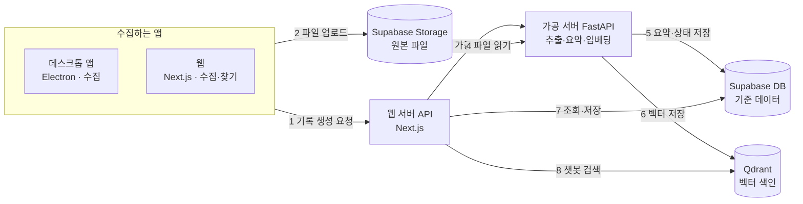

# 시스템 구성

데이터는 세 곳에 나뉘어 저장된다. 원본 파일은 Supabase Storage, 기록·그룹·메모·연결 같은 일반 데이터는 Supabase DB, 검색용 벡터는 Qdrant다. Supabase DB가 기준 데이터이고, Qdrant는 DB와 Storage로 다시 만들 수 있는 색인이다.

1. 기록 생성 요청: 데스크톱 앱과 웹이 웹 서버 API에 기록을 만들고 업로드 권한을 받는다
2. 파일 업로드: 파일을 Storage에 직접 올린다. 메모·하이라이트·URL·영상 링크는 이 단계가 없다
3. 가공 요청: 업로드가 끝나면 웹 서버 API가 가공 서버(FastAPI)에 가공을 요청한다
4. 파일 읽기: 가공 서버가 Storage에서 파일을 받는다
5. 요약·상태 저장: 요약본과 처리 상태를 Supabase DB에 저장한다
6. 벡터 저장: 요약본 벡터와 원문 조각 벡터를 Qdrant에 올린다
7. 조회·저장: 웹 서버 API가 기록, 그룹, 메모, 연결을 Supabase DB에서 읽고 쓴다
8. 챗봇 검색: 웹 서버 API가 질문을 벡터로 바꿔 Qdrant에서 찾고, DB에서 기록을 불러와 답한다

## 로그인
- Supabase 인증의 구글 로그인을 쓴다
- 데스크톱 앱은 로컬 주소로 돌려받기(loopback) + PKCE
  1. 앱이 127.0.0.1의 임의 포트에 임시 서버를 열고 브라우저로 웹 로그인 페이지를 연다
  2. 웹에서 로그인 성공 → http://127.0.0.1:포트/callback?code=일회용코드
  3. 앱이 코드와 PKCE 검증값을 서버에 보내 토큰으로 바꾸고 임시 서버를 닫는다

## 미정
- 연결 추천이 Qdrant를 읽는 위치
- AI 그룹 추천을 처리하는 위치
