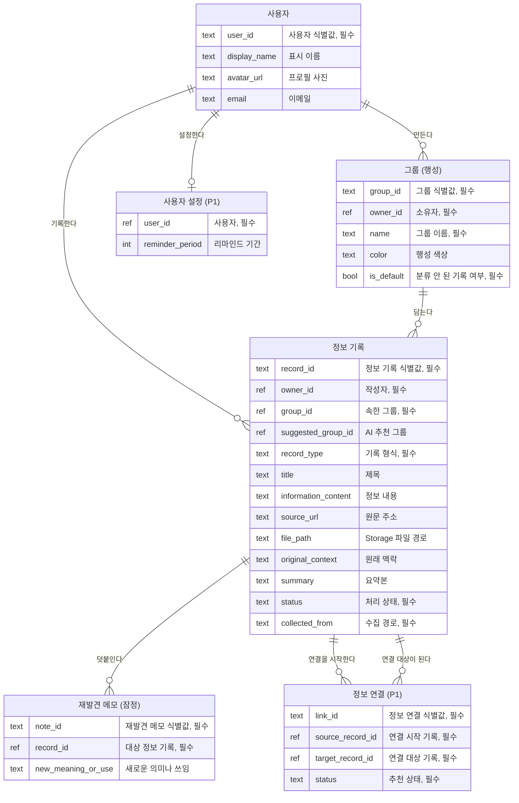

# 데이터 구성

예시값은 화면 확인용으로 지어낸 값이다. 모든 테이블에는 만든 시각(created_at)이 들어가며 표에서는 생략했다.

## 구성도 (Supabase DB)

그룹 테이블 이름은 SQL 예약어 group과 겹치지 않게 record_group으로 한다.

## 사용자 (user)
구글 로그인(Supabase 인증)한 사용자를 구분한다.

| 필드 | 타입 | 필수 | 설명 | 예시값 |
| --- | --- | --- | --- | --- |
| user_id | 글자 | 필수 | Supabase 인증 사용자 id. 이메일을 식별값으로 쓰지 않는다 | user_001 |
| display_name | 글자 | 선택 | 처음엔 구글 이름(name)을 복사, 사용자가 설정에서 변경 가능 | 김우주 |
| avatar_url | 글자 | 선택 | 구글 프로필 사진(picture) 주소 | https://example.com/a.png |
| email | 글자 | 선택 | 구글 이메일. 알림 채널이 정해진 뒤 필요 없으면 삭제 검토 | user@example.com |

- 가입할 때 구글 정보(name, picture, email)를 이 테이블로 복사하는 트리거를 둔다
- Supabase 인증 정보가 바뀔 때는 avatar_url과 email만 다시 복사한다. display_name은 사용자가 바꾼 이름을 지키기 위해 덮어쓰지 않는다
- [확인 필요: 표시 이름 길이와 빈 값 규칙]
- 세 필드 모두 선택 칸. 쓰지 않게 되면 쓰는 곳(웹 화면, 타입)과 같은 PR에서 지운다
- [확인 필요: 구글이 이름을 주지 않았을 때 사이드바에 보일 값] 구글은 이름과 사진을 항상 준다고 보장하지 않는다

## 그룹 (record_group)
기록을 묶는 행성. 이름을 바꿔도 기록은 고치지 않는다.

| 필드 | 타입 | 필수 | 설명 | 예시값 |
| --- | --- | --- | --- | --- |
| group_id | 글자 | 필수 | 그룹 식별값 | group_001 |
| owner_id | 참조 | 필수 | 그룹을 만든 사용자 | user_001 |
| name | 글자 | 필수 | 행성 이름. 새로 만들 때 AI가 추천 | 개발 |
| color | 글자 | 선택 | 행성과 목록 점의 색 [확인 필요: 지정 방식] | 파랑 |
| is_default | 참/거짓 | 필수 | '분류 안 된 기록'이면 참. 사용자마다 1개 | 거짓 |

삭제: 빈 그룹은 바로 삭제. 기록이 있으면 '다른 그룹으로 옮기고 삭제' 또는 '기록까지 모두 삭제'를 사용자가 고른다.

## 정보 기록 (information_record)
사용자가 저장한 정보 하나. 정보 내용과 원래 맥락은 선택이다.

| 필드 | 타입 | 필수 | 설명 | 예시값 |
| --- | --- | --- | --- | --- |
| record_id | 글자 | 필수 | 정보 기록 식별값 | record_001 |
| owner_id | 참조 | 필수 | 기록한 사용자 | user_001 |
| group_id | 참조 | 필수 | 속한 그룹. 처음엔 AI 추천 그룹, 없으면 '분류 안 된 기록' | group_001 |
| suggested_group_id | 참조 | 선택 | AI가 추천한 그룹. 사용자가 바꿔도 남긴다 | group_002 |
| record_type | 글자 | 필수 | 메모, 하이라이트, URL, 파일, 캡처 [확인 필요: 영상 링크를 따로 구분할지] | url |
| title | 글자 | 선택 | 비우면 메모 첫 줄이나 파일 이름 | 프롬프트 작성 가이드 |
| information_content | 글자 | 선택 | 직접 쓴 메모 글이나 하이라이트 문장 | 맥락, 형식, 판단 기준을 함께 준다 |
| source_url | 글자 | 선택 | URL·영상 링크의 원문, 하이라이트 출처 페이지 | https://example.com/guide |
| file_path | 글자 | 선택 | Supabase Storage 파일 위치 | user_001/record_001.pdf |
| file_type | 글자 | 선택 | 파일 형식 | pdf |
| file_size | 숫자 | 선택 | 파일 크기 (10MB 이하) | 640KB |
| original_context | 글자 | 선택 | 저장할 때 남긴 맥락이나 이유 | 직무교육 실습 중 저장 |
| summary | 글자 | 선택 | AI 요약. 하이라이트는 만들지 않음 [확인 필요: 메모도 요약할지] | 좋은 프롬프트의 세 요소 정리 |
| status | 글자 | 필수 | uploading, queued, processing, done, failed | done |
| error_message | 글자 | 선택 | 가공 실패 이유 | 원문을 가져오지 못함 |
| collected_from | 글자 | 필수 | desktop, web, mcp | desktop |
| embedding_model | 글자 | 선택 | 벡터를 만든 모델. Qdrant 재생성 때 확인 | embedding-v1 |
| is_favorite | 참/거짓 | 선택 | [확인 필요: MVP 포함 여부] | 참 |
| last_viewed_at | 날짜 | 선택 | P1. 블랙홀 기준이 '마지막으로 본 날'이면 필요 | 2026-11-26 |

넣은 날은 만든 시각이며 기간 필터의 기준이다.

## 재발견 메모 (rediscovery_note) — 잠정
기록에 날짜별로 덧붙이는 새로운 의미나 쓰임. 이전 메모를 덮어쓰지 않는다. UI가 정해지지 않아 필드는 잠정이다.

| 필드 | 타입 | 필수 | 설명 | 예시값 |
| --- | --- | --- | --- | --- |
| note_id | 글자 | 필수 | 재발견 메모 식별값 | note_001 |
| record_id | 참조 | 필수 | 메모를 덧붙인 정보 기록 | record_001 |
| new_meaning_or_use | 글자 | [확인 필요] | 새로 발견한 의미나 쓰임 | 다음 팀 프로젝트 기획서에 써먹을 수 있겠다 |

## 정보 연결 (information_link) — P1
두 기록을 잇는 선. AI가 후보를 만들고 사용자가 수락하면 별자리 선이 된다.

| 필드 | 타입 | 필수 | 설명 | 예시값 |
| --- | --- | --- | --- | --- |
| link_id | 글자 | 필수 | 연결 식별값 | link_001 |
| source_record_id | 참조 | 필수 | 연결의 한쪽 기록 | record_001 |
| target_record_id | 참조 | 필수 | 연결의 다른 쪽 기록 | record_002 |
| status | 글자 | 필수 | suggested, accepted, rejected | accepted |
| decided_at | 날짜 | 선택 | 수락·거절 시각 | 2026-11-26 |

[확인 필요: 연결에 방향이 있는지. 없다면 A–B와 B–A 중복 저장을 막아야 함]
[확인 필요: 사용자가 직접 연결할 수 있다면 만든 주체 칸 추가]

## 사용자 설정 (user_settings) — P1

| 필드 | 타입 | 필수 | 설명 | 예시값 |
| --- | --- | --- | --- | --- |
| user_id | 참조 | 필수 | 설정의 주인. 사용자마다 1개 | user_001 |
| reminder_period | 숫자 | 선택 | 블랙홀 기간 [확인 필요: 단위와 기본값] | 30 |

## Supabase Storage
- 출처 링크(source_url)가 있는 파일은 가공 성공(done) 후 Storage 원본을 지우고 출처 링크로 본다. 출처 링크가 없는 파일(내 컴퓨터에서 올린 파일, 화면 캡처)은 원본을 유지한다. 가공에 실패한 파일은 지우지 않는다
- [확인 필요: 삭제 후 file_path를 비울지, 삭제 시각을 따로 남길지]
- 지원 형식: csv, txt, md, jpeg, jpg, png, svg, HTML, PDF. 파일 1개 10MB까지
- 메모·하이라이트·URL·영상 링크 기록은 Storage를 쓰지 않는다
- [확인 필요: 파일 경로 규칙]
- [확인 필요: 파일을 보여 주는 방식. 공개 주소, 기한이 있는 서명 주소]

## Qdrant
기록 1개에서 벡터가 여러 개 나온다 (요약본 1개 + 원문 조각 여러 개). 벡터 식별값은 기록 식별값과 다르다.

| payload | 필수 | 설명 | 예시값 |
| --- | --- | --- | --- |
| user_id | 필수 | 내 기록 안에서만 찾도록 거르는 값 | user_001 |
| record_id | 필수 | 벡터가 나온 기록 | record_001 |
| vector_kind | 필수 | summary, chunk | chunk |
| chunk_index | 선택 | 원문 조각 순서. chunk일 때만 | 3 |

- 원문 조각 글은 저장하지 않는다. 원문 조각 벡터는 관련 기록을 찾는 데만 쓰고, 챗봇 답변은 요약본·하이라이트·메모 글로 만든다
- 다시 만들기: DB 요약본과 Storage 파일로 다시 만든다. URL·영상 링크와 원본을 지운 출처 링크 파일은 원문을 다시 가져와야 하며, 링크가 사라졌으면 원문 조각 벡터는 복구할 수 없다
- [확인 필요: 컬렉션을 하나로 둘지 둘로 나눌지]
- [확인 필요: 요약본이 없는 하이라이트·메모의 벡터 재료]
- [확인 필요: group_id도 저장할지]

## 관계
- 사용자 1명 → 그룹 여러 개, 정보 기록 여러 개
- 그룹 1개 → 정보 기록 여러 개. 정보 기록은 그룹 하나에만 속한다
- 정보 기록 1개 → 재발견 메모 여러 개, 정보 연결 여러 개, Storage 파일 0~1개, Qdrant 벡터 여러 개
- 사용자 1명 → 사용자 설정 0~1개 (P1)
