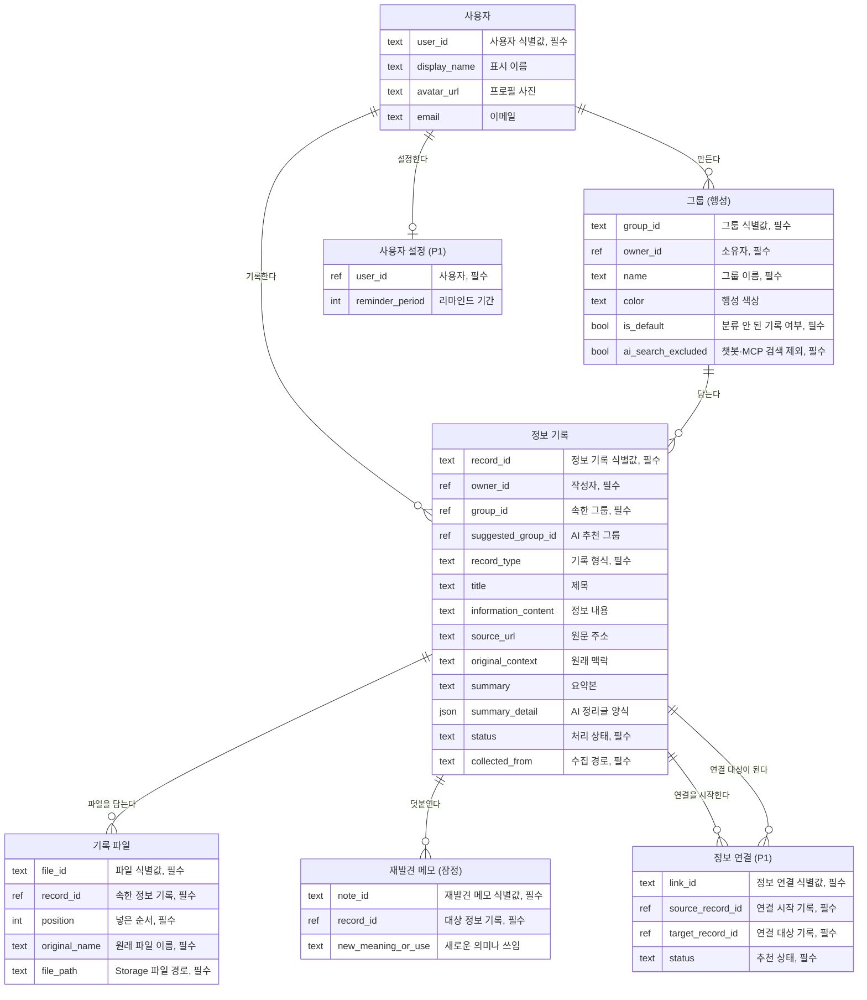

# 데이터 구성

예시값은 화면 확인용으로 지어낸 값이다. 모든 테이블에는 만든 시각(created_at)이 들어가며 표에서는 생략했다.

실제 테이블은 supabase/migrations가 기준이다. 식별값(user_id, group_id, record_id)은 uuid, 정보 기록의 group_id는 (group_id, owner_id) 복합 외래 키로 같은 주인의 그룹만 참조한다. 파일은 비공개 버킷 `records`(10MB, 지원 형식만)에 저장하고, 파일 정보는 record_file 테이블에 둔다 (기록 1개에 0~10개).

## 구성도 (Supabase DB)



그룹 테이블 이름은 SQL 예약어 group과 겹치지 않게 record_group으로 한다.

## 사용자 (app_user)
테이블 이름은 Postgres 예약어 user를 피해 app_user로 한다 (그룹의 record_group과 같은 이유).

구글 로그인(Supabase 인증)한 사용자를 구분한다.

| 필드 | 타입 | 필수 | 설명 | 예시값 |
| --- | --- | --- | --- | --- |
| user_id | 글자 | 필수 | Supabase 인증 사용자 id. 이메일을 식별값으로 쓰지 않는다 | user_001 |
| display_name | 글자 | 선택 | 처음엔 구글 이름(name)을 복사, 사용자가 설정에서 변경 가능 | 김우주 |
| avatar_url | 글자 | 선택 | 구글 프로필 사진(picture) 주소 | https://example.com/a.png |
| email | 글자 | 선택 | 구글 이메일. 알림 채널이 정해진 뒤 필요 없으면 삭제 검토 | user@example.com |

- 가입할 때 구글 정보(name, picture, email)를 이 테이블로 복사하는 트리거를 둔다
- Supabase 인증 정보가 바뀔 때는 avatar_url과 email만 다시 복사한다. display_name은 사용자가 바꾼 이름을 지키기 위해 덮어쓰지 않는다
- [확인 필요: 표시 이름 길이와 빈 값 규칙]
- 세 필드 모두 선택 칸. 쓰지 않게 되면 쓰는 곳(웹 화면, 타입)과 같은 PR에서 지운다
- [확인 필요: 구글이 이름을 주지 않았을 때 사이드바에 보일 값] 구글은 이름과 사진을 항상 준다고 보장하지 않는다

## 그룹 (record_group)
기록을 묶는 행성. 이름을 바꿔도 기록은 고치지 않는다.

| 필드 | 타입 | 필수 | 설명 | 예시값 |
| --- | --- | --- | --- | --- |
| group_id | 글자 | 필수 | 그룹 식별값 | group_001 |
| owner_id | 참조 | 필수 | 그룹을 만든 사용자 | user_001 |
| name | 글자 | 필수 | 행성 이름. 새로 만들 때 AI가 추천 | 개발 |
| color | 글자 | 선택 | 행성과 목록 점의 색 [확인 필요: 지정 방식] | 파랑 |
| is_default | 참/거짓 | 필수 | '분류 안 된 기록'이면 참. 사용자마다 1개 | 거짓 |
| ai_search_excluded | 참/거짓 | 필수 | 참이면 이 그룹의 기록은 웹 챗봇과 MCP 찾기에서 검색하지 않는다. 기본값 거짓. '분류 안 된 기록'도 설정 가능 | 거짓 |

챗봇·MCP 검색 제외: 기록마다가 아니라 그룹 단위로 설정한다. 가공(요약·임베딩), 연결 추천, AI 그룹 추천은 제외 여부와 상관없이 그대로 동작한다. 기록을 제외 그룹으로 옮기면 그때부터 검색에서 빠진다.

삭제: 빈 그룹은 바로 삭제. 기록이 있으면 '다른 그룹으로 옮기고 삭제' 또는 '기록까지 모두 삭제'를 사용자가 고른다.

## 정보 기록 (information_record)
사용자가 저장한 정보 하나. 정보 내용과 원래 맥락은 선택이다. 파일 정보는 아래 record_file에 둔다.

제목(title)을 비우면 메모·하이라이트는 첫 줄, URL·영상은 주소로 채워 저장한다. 파일 기록은 빈 제목을 저장하지 않고, 화면에서 첫 파일 이름(확장자 제외)을 보여 준다 (packages/shared `displayRecordTitle`). 저장하면 파일 이름이 '제목1, 제목2'로 바뀌기 때문이다.

| 필드 | 타입 | 필수 | 설명 | 예시값 |
| --- | --- | --- | --- | --- |
| record_id | 글자 | 필수 | 정보 기록 식별값 | record_001 |
| owner_id | 참조 | 필수 | 기록한 사용자 | user_001 |
| group_id | 참조 | 필수 | 속한 그룹. 처음엔 AI 추천 그룹, 없으면 '분류 안 된 기록' | group_001 |
| suggested_group_id | 참조 | 선택 | AI가 추천한 그룹. 사용자가 바꿔도 남긴다 | group_002 |
| record_type | 글자 | 필수 | memo(메모), highlight(하이라이트), url, video(영상 링크), file(파일), capture(캡처), chat(챗봇 답변을 기록으로 저장) | url |
| title | 글자 | 선택 | 비우면 메모 첫 줄이나 파일 이름 | 프롬프트 작성 가이드 |
| information_content | 글자 | 선택 | 메모 기록의 본문, 하이라이트 문장. 다른 형식에는 쓰지 않는다 | 맥락, 형식, 판단 기준을 함께 준다 |
| source_url | 글자 | 선택 | URL·영상 링크의 원문, 하이라이트 출처 페이지 | https://example.com/guide |
| original_context | 글자 | 선택 | 화면의 '메모'. 저장할 때 남긴 맥락이나 이유, 기록 상세에서 고치면 자동 저장. '메모에 옮기기'로 AI 분석 핵심 내용이 덧붙기도 한다 | 직무교육 실습 중 저장 |
| summary | 글자 | 선택 | AI 분석 결과. 한 줄 요약 + 핵심 포인트. 'AI 분석하기'·챗봇 요청 때만 만든다. 메모·하이라이트는 만들지 않음. 사용자가 고칠 수 없음 | AI에게 맥락, 형식, 판단 기준을 함께 줘야 한다 |
| summary_detail | JSON | 선택 | AI 정리글 전체 (아래 'AI 정리글 양식'). chat 기록은 근거 기록 id를 sources에 둔다 | (아래 예시) |
| analysis_status | 글자 | 필수 | AI 분석 상태: none(분석 전), analyzing(분석 중), done(분석 완료), failed(분석 실패). 기본값 none, chat 기록은 done | none |
| analyzed_at | 날짜 | 선택 | 마지막 분석 시각. 화면의 'AI 분석 · 11월 27일 23:27' | 2026-11-27 23:27 |
| analyzed_context | 글자 | 선택 | 분석할 때의 메모. 지금 메모와 다를 때만 '다시 분석'을 허용한다 | 여러개의 나비 시안 |
| analysis_moved_at | 날짜 | 선택 | '메모에 옮기기'를 누른 시각. 같은 분석은 한 번만 옮긴다. 다시 분석하면 비운다 | 2026-11-27 23:30 |
| status | 글자 | 필수 | 저장·자동 가공(글자 추출 + 원문 조각 벡터) 상태: uploading, queued, processing, done, failed, deleting (삭제 중). AI 분석 상태는 analysis_status | done |
| error_message | 글자 | 선택 | 가공 실패 이유 | 원문을 가져오지 못함 |
| collected_from | 글자 | 필수 | desktop, web, mcp | desktop |
| embedding_model | 글자 | 선택 | 벡터를 만든 모델. Qdrant 재생성 때 확인 | embedding-v1 |
| is_favorite | 참/거짓 | 선택 | [확인 필요: MVP 포함 여부] 아직 migration에 없음 | 참 |
| last_viewed_at | 날짜 | 선택 | P1. 블랙홀 기준이 '마지막으로 본 날'이면 필요. 아직 migration에 없음 | 2026-11-26 |

넣은 날은 만든 시각이며 기간 필터의 기준이다.

## 기록 파일 (record_file)
정보 기록에 붙은 파일 하나. 기록 1개에 0~10개, 파일 1개 10MB·기록 합계 50MB까지. 기록을 지우면 함께 지워진다.

| 필드 | 타입 | 필수 | 설명 | 예시값 |
| --- | --- | --- | --- | --- |
| file_id | 글자 | 필수 | 파일 식별값 | file_001 |
| record_id | 참조 | 필수 | 속한 정보 기록. (record_id, owner_id) 복합 외래 키로 같은 주인의 기록만 | record_001 |
| owner_id | 참조 | 필수 | 올린 사용자 | user_001 |
| position | 숫자 | 필수 | 사용자가 넣은 순서 1~10. 화면 이름 번호 | 2 |
| original_name | 글자 | 필수 | 올린 파일 이름. 이미지를 줄여 올리면 확장자가 .jpg로 바뀐 이름 | 우주기록 시안.png |
| file_path | 글자 | 필수 | Storage `records` 버킷 안 위치 `user_id/record_id/file_id.확장자` | user_001/record_001/file_001.png |
| file_type | 글자 | 필수 | 확장자 | png |
| file_size | 숫자 | 필수 | 크기 (10MB 이하) | 640KB |

화면 이름 (packages/shared `displayFileName`, 저장하지 않음):
- 기록 제목이 있으면 파일 1개는 '제목', 여러 개는 '제목1', '제목2'… (번호는 position, 붙여 쓰기). 예) '우주기록 시안' + 10개 → '우주기록 시안1' … '우주기록 시안10'
- 기록 제목이 비어 있으면 각 파일의 원래 이름

## AI 정리글 양식
사용자가 'AI 분석하기'(다시 분석)를 누르거나 챗봇으로 기록 분석을 요청하면 가공 서버가 URL, 파일, 캡처, 영상 링크 기록을 이 양식으로 정리해 summary_detail에 저장한다 (저장 때 자동으로 만들지 않는다). 메모·하이라이트는 정리하지 않는다. 기록 상세에는 한 줄 요약, 핵심 포인트(최대 3개), 함께 볼 만한 기록(연관 기록)만 보이고 나머지 항목은 저장만 한다. "무슨 내용인가"보다 "언제 다시 쓸까"를 떠올리게 하는 것이 목적이다.

**공통 항목**

| 항목 | 키 | 내용 | 재발견에 쓰이는 곳 |
| --- | --- | --- | --- |
| 한 줄 요약 | one_line | 한 문장으로 핵심 | 목록, 행성 패널, 우주에서 별 미리보기 |
| 핵심 포인트 | key_points | 3개 이내 | 기록 상세 첫 화면 |
| 자료 유형 | content_kind | 개념 설명 / 방법·튜토리얼 / 사례·레퍼런스 / 데이터·지표 / 도구 소개 / 템플릿 / 의견·회고 중 하나 | 목록 필터, AI 그룹 추천 재료 |
| 이럴 때 다시 보세요 | use_when | 이 자료가 쓸모 있을 상황 1~2개 | 블랙홀, 챗봇 답변, 리마인드 문구 |
| 바로 써먹을 것 | actionables | 체크리스트, 명령어, 문장 틀 등 (있을 때만) | 기록 상세 |
| 키워드 | keywords | 5개 이내 | 검색, 연결 추천 재료 |
| 관련 직군 | roles | PO·PM, 마케팅, 개발, 디자인 중 정말 관련 있는 직군만 최대 2개. 사용자가 고르지 않고 AI가 기록마다 판단한다. 관련 직군이 없으면 빈 목록 | 목록 필터, 직군 노트를 쓸 직군 판단 |

**직군 노트 (role_notes, roles에 든 직군에만)**

직군마다 "이 자료를 이렇게 참고할 수 있다"를 한 줄로 적는다. 직군 정보는 키워드(keywords)에 섞지 않는다. 키워드는 내용을 나타내는 칸이라, 섞으면 검색·연결 추천 재료가 흐려지기 때문이다. 아래는 직군별로 노트에 담을 관점이다.

| 직군 | 뽑아낼 것 |
| --- | --- |
| PO·PM | 풀려는 문제, 가설, 판단 기준·프레임워크, 지표, 사용자 이야기 |
| 마케팅 | 타깃, 핵심 메시지, 채널, 성과 지표, 따라 쓸 만한 카피·사례 |
| 개발 | 기술·도구와 버전, 핵심 개념, 코드·명령어, 오류와 해결 방법 |
| 디자인 | UI 패턴, 디자인 원칙, 컴포넌트, 레퍼런스(어떤 화면에 참고할지), 도구 |

**예시**

```json
{
  "one_line": "AI에게 맥락, 결과 형식, 판단 기준을 함께 줘야 원하는 답이 나온다",
  "key_points": ["맥락을 먼저 설명", "원하는 결과물의 형식을 지정", "좋고 나쁨의 판단 기준을 제시"],
  "content_kind": "방법·튜토리얼",
  "use_when": ["팀원에게 AI 업무 요청 가이드를 만들 때", "PRD 초안을 AI로 쓸 때"],
  "actionables": ["맥락 / 형식 / 판단 기준 세 줄 템플릿"],
  "keywords": ["프롬프트", "AI 협업", "업무 요청"],
  "roles": ["PO·PM", "개발"],
  "role_notes": {
    "PO·PM": "요구사항을 AI에 넘길 때 판단 기준까지 적으면 재작업이 준다",
    "개발": "코드 생성 요청 시 출력 형식(언어, 파일 구조)을 지정하는 데 응용"
  }
}
```

- 요약본 벡터는 one_line + key_points + use_when을 합친 글로 만든다. 사용자가 상황으로 물어도("기획서 우선순위 정할 때 참고할 자료") 찾을 수 있게 하기 위해서다
- 사용자 직군은 저장하지 않는다. 기록 상세에서는 관련 직군 노트를 모두 보여 준다
- [확인 필요: MVP 범위. 공통 항목만 할지, 직군 노트까지 할지]
- [확인 필요: 자료 유형 목록. 실제 저장 자료를 모아 디자이너·PO와 다듬기]

## 재발견 메모 (rediscovery_note) — 잠정
기록에 날짜별로 덧붙이는 새로운 의미나 쓰임. 이전 메모를 덮어쓰지 않는다. UI가 정해지지 않아 필드는 잠정이다.

| 필드 | 타입 | 필수 | 설명 | 예시값 |
| --- | --- | --- | --- | --- |
| note_id | 글자 | 필수 | 재발견 메모 식별값 | note_001 |
| record_id | 참조 | 필수 | 메모를 덧붙인 정보 기록 | record_001 |
| new_meaning_or_use | 글자 | [확인 필요] | 새로 발견한 의미나 쓰임 | 다음 팀 프로젝트 기획서에 써먹을 수 있겠다 |

## 정보 연결 (information_link) — P1
두 기록을 잇는 선. AI가 후보를 만들고 사용자가 수락하면 별자리 선이 된다.

| 필드 | 타입 | 필수 | 설명 | 예시값 |
| --- | --- | --- | --- | --- |
| link_id | 글자 | 필수 | 연결 식별값 | link_001 |
| source_record_id | 참조 | 필수 | 연결의 한쪽 기록 | record_001 |
| target_record_id | 참조 | 필수 | 연결의 다른 쪽 기록 | record_002 |
| status | 글자 | 필수 | suggested, accepted, rejected | accepted |
| decided_at | 날짜 | 선택 | 수락·거절 시각 | 2026-11-26 |

[확인 필요: 연결에 방향이 있는지. 없다면 A–B와 B–A 중복 저장을 막아야 함]
[확인 필요: 사용자가 직접 연결할 수 있다면 만든 주체 칸 추가]

## 사용자 설정 (user_settings) — P1

| 필드 | 타입 | 필수 | 설명 | 예시값 |
| --- | --- | --- | --- | --- |
| user_id | 참조 | 필수 | 설정의 주인. 사용자마다 1개 | user_001 |
| reminder_period | 숫자 | 선택 | 블랙홀 기간 [확인 필요: 단위와 기본값] | 30 |

## 기록 삭제 절차
기록 하나를 지울 때 Supabase DB, Qdrant, Storage에 있는 것을 모두 지운다. 세 곳은 한 번에 지울 수 없어서, 중간에 실패해도 남은 것을 찾아 마저 지울 수 있게 아래 순서를 지킨다.

1. 사용자에게 확인 창을 띄운다. 삭제는 되돌릴 수 없다 (휴지통 없음)
2. DB의 status를 deleting으로 바꾼다. 이때부터 화면, 챗봇, MCP 찾기, 연관 기록에서 바로 보이지 않는다
3. Qdrant에서 그 record_id의 벡터를 모두 지운다 (요약본, 원문 조각)
4. Storage 원본 파일을 지운다 (출처 링크 파일이라 이미 지워졌으면 생략)
5. DB에서 기록을 지운다. 재발견 메모와 연결(시작·대상 모두)은 외래 키의 ON DELETE CASCADE로 함께 지워진다

- DB를 마지막에 지우는 이유: DB가 기준 데이터라서, 3·4번이 실패해도 deleting 기록이 남아 있으면 무엇을 마저 지울지 알 수 있다
- 3·4번이 실패하면 deleting 상태로 남기고 주기적으로 다시 시도한다. [확인 필요: 다시 시도하는 주체. 가공 서버의 주기 작업, 웹 서버]
- 가공 중에 지운 경우: 가공 서버는 Qdrant에 저장하기 직전에 기록의 status를 다시 확인하고, deleting이거나 기록이 없으면 저장하지 않고 멈춘다
- 같은 절차를 재사용한다: 기록 상세의 지우기, 그룹을 '기록까지 모두 삭제', 블랙홀의 지우기

## Supabase Storage
- 출처 링크(source_url)가 있는 파일은 가공 성공(done) 후 Storage 원본을 지우고 출처 링크로 본다. 출처 링크가 없는 파일(내 컴퓨터에서 올린 파일, 화면 캡처)은 원본을 유지한다. 가공에 실패한 파일은 지우지 않는다
- [확인 필요: 삭제 후 record_file.file_path를 비울지, 삭제 시각을 따로 남길지]
- 지원 형식: csv, txt, md, jpeg, jpg, png, svg, HTML, PDF. 파일 1개 10MB까지, 기록 1개에 파일 10개·합계 50MB까지
- 경로: `user_id/record_id/file_id.확장자` (record_file 이전에 만든 파일은 `user_id/record_id.확장자`)
- 10MB가 넘는 jpg·png는 올리기 전에 클라이언트가 줄인다: 긴 변 4096px 이하, JPEG로 다시 압축(품질 0.9→0.5 단계). 원본은 사용자 컴퓨터에 남는다. PDF·글 파일은 줄이지 않고 거절
- 메모·하이라이트·URL·영상 링크 기록은 Storage를 쓰지 않는다
- [확인 필요: 파일 경로 규칙]
- [확인 필요: 파일을 보여 주는 방식. 공개 주소, 기한이 있는 서명 주소]

## Qdrant
기록 1개에서 벡터가 여러 개 나온다 (요약본 1개 + 원문 조각 여러 개). 벡터 식별값은 기록 식별값과 다르다.

| payload | 필수 | 설명 | 예시값 |
| --- | --- | --- | --- |
| user_id | 필수 | 내 기록 안에서만 찾도록 거르는 값 | user_001 |
| record_id | 필수 | 벡터가 나온 기록 | record_001 |
| group_id | 필수 | 기록이 속한 그룹. 챗봇·MCP 검색 제외 그룹을 거르는 데 쓴다 | group_001 |
| vector_kind | 필수 | summary, chunk | chunk |
| chunk_index | 선택 | 원문 조각 순서. chunk일 때만 | 3 |

- 요약본 벡터의 재료는 AI 정리글의 one_line + key_points + use_when이다
- 연관 기록 (기록 상세): 이 기록의 요약본 벡터로 검색해 유사도 0.8 이상 중 점수가 가장 높은 기록 최대 3개를 보여 준다. 자기 자신 제외, user_id 필터 필수. 결과는 DB에서 다시 확인해 없거나 deleting인 기록을 뺀다. 연결(모아보기·별자리)과는 별개이며 챗봇·MCP 검색 제외 설정은 적용하지 않는다
- 원문 조각 글은 저장하지 않는다. 원문 조각 벡터는 관련 기록을 찾는 데만 쓰고, 챗봇 답변은 요약본·하이라이트·메모 글로 만든다
- 다시 만들기: DB 요약본과 Storage 파일로 다시 만든다. URL·영상 링크와 원본을 지운 출처 링크 파일은 원문을 다시 가져와야 하며, 링크가 사라졌으면 원문 조각 벡터는 복구할 수 없다
- [확인 필요: 컬렉션을 하나로 둘지 둘로 나눌지]
- [확인 필요: 요약본이 없는 하이라이트·메모의 벡터 재료]
- 웹 챗봇과 MCP 찾기는 ai_search_excluded가 참인 그룹의 기록을 결과에서 뺀다
- 제외 방식: 검색할 때 ai_search_excluded가 참인 그룹 id 목록을 조건으로 넘겨 group_id가 그 목록에 있는 벡터를 뺀다. 제외를 켜고 끌 때는 Qdrant를 고치지 않는다
- group_id 갱신: 가공 서버는 저장 직전 DB의 현재 group_id를 읽어 넣는다. 웹 서버는 기록의 그룹을 바꾸거나 그룹 삭제 시 기록을 옮길 때 그 record_id의 벡터 group_id를 함께 갱신한다

## 관계
- 사용자 1명 → 그룹 여러 개, 정보 기록 여러 개
- 그룹 1개 → 정보 기록 여러 개. 정보 기록은 그룹 하나에만 속한다
- 정보 기록 1개 → 재발견 메모 여러 개, 정보 연결 여러 개, 기록 파일(record_file) 0~10개, Qdrant 벡터 여러 개
- 사용자 1명 → 사용자 설정 0~1개 (P1)
