# SPACELOG 화면 정의서

- 기준 파일: `docs/design/spacelog-prototype.html` (홈 `W01_Home_v3`, 그룹 창 `W02_PlanetPanel_v2`, 기록 상세 `W03_StarDetail`, Space 엔진 `spacelog-3d.js`)
- 작성일: 2026-11-28
- 디자인 값(색·글자·간격)은 `design.md`를 따릅니다. 이 문서는 **동작, 상태, 규칙, 예외**를 적습니다.
- 각 기능은 같은 틀로 적습니다: 흐름 / 상태 / 규칙·제한 / 예외 / 반응형 / 문구 / 미정·프로토타입 한정. 해당 없는 칸은 "—".

---

## 0. 공통 규칙

### 0-1. 용어

| 화면에 쓰는 말 | 뜻 | 쓰지 않는 말 |
| --- | --- | --- |
| 기록 | 저장한 파일·링크·메모·이미지 하나 | 별 |
| 그룹 | 기록을 묶는 주제. Space에서는 행성 모양 | 행성, 주제, 카테고리 |
| 분류 안 된 기록 | 그룹을 정하지 않은 기록. Space에서는 성운 모양, 개수는 ‘조각 n’ |  |
| List / Space | 보기 방식 두 가지. 문서 목록 / 우주 공간 | 1D, 3D |
| 모아보기 | 여러 기록을 골라 한곳에 모은 것 (지금은 보류, 4절) | 이어보기, 별자리 |
| 리마인드 | N일 전 오늘 넣은 기록을 다시 보여 주는 것 | 재발견 혜성 |
| 우주먼지 | 도움말 챗봇 이름. 버튼 글자는 ‘물어보기’ |  |

### 0-2. 화면 폭 기준

| 구간 | 형식 |
| --- | --- |
| 1100px 이상 | PC 형식. 목록 창은 좌상단 떠 있는 창 |
| 760 ~ 1099px | 모바일 형식 상단바 + PC 형식 창(그룹 창, 기록 넣기, 챗봇) |
| 760px 미만 | 모바일 형식. 그룹 창·기록 상세는 좌우·아래 여백 없이 가득, 기록 넣기·물어보기·긴 답 보기는 전체 화면 페이지 |

- 모바일 형식일 때 `html[data-sl-mob="1"]`.
- 모바일 형식에서는 호버 효과를 쓰지 않습니다.

### 0-3. 기간

| 값 | 포함 범위 |
| --- | --- |
| 오늘 | 오늘 0시 ~ 지금 |
| 이번 주 | 월요일 0시 ~ 지금 |
| 이번 달 | 이번 달 1일 0시 ~ 지금 |
| 전체 | 모든 기록 |
| 직접 지정 | 사용자가 고른 시작일 – 종료일 (2026-11-28 결정) |

- 날짜 기준은 **기록을 넣은 시각**(`addedAt`)입니다. 메모를 고친 시각이 아닙니다.
- 첫 진입 기본값은 ‘오늘’. 오늘 기록이 0개면 ‘이번 주’로 열고 안내: `오늘은 아직 기록이 없어서 이번 주를 보여드려요`
- 넣은 날 표기: 오늘 → `오늘`, 어제 → `어제`, 2~6일 전 → `n일 전`, 7일 전부터 → `11월 20일`.
- ‘전체’에서 ‹ › 를 누르면 토스트: `전체 기간에서는 앞뒤로 넘길 수 없어요`

### 0-4. 토스트와 확인

- 토스트: 화면 아래 가운데, 약 2.4초. 기록 넣기 직후 알림은 버튼 바로 위(아래에서 80px).
- 되돌릴 수 없는 동작(기록 삭제, 그룹 삭제)은 **같은 자리에서 한 번 더** 묻습니다. 브라우저 확인창을 쓰지 않습니다.
- 버튼 안내 말풍선(예: 체크 없이 ‘그룹 이동’): 버튼 바로 아래, 2.2초 뒤 사라짐.

### 0-5. 저장 위치 (프로토타입)

프로토타입은 서버 없이 브라우저(localStorage)에 저장합니다. 실제 구현에서는 계정 데이터로 옮겨야 합니다.

| 키 | 내용 |
| --- | --- |
| `spacelog_view_v1` | 마지막 보기 방식 (List / Space) |
| `spacelog_chat_hist_v1` | 챗봇 대화 목록 |
| `spacelog_dust_pos_v5` | 물어보기 버튼 위치 |
| `spacelog_ai_v1` | 기록별 AI 분석 결과 |
| `spacelog_google_v1` | Google 연동 표시 상태 |
| `spacelog_depth_v1` | Space 깊이 순서 |

### 0-6. 키보드

- Esc: 한 단계씩 닫기 (상세 → 그룹 창 → 기본 화면).
- 입력칸에 포커스가 있으면 Space 이동 키를 받지 않습니다.

### 0-7. 공통 상태와 오류

| 상황 | 처리 | 문구 |
| --- | --- | --- |
| 앱 첫 로딩 | 로고와 안내, 점 3개 | `SPACELOG`, `우주를 불러오는 중이에요` |
| Space 보기 준비 | Space를 여는 동안 안내 | `Space 보기를 준비하고 있어요`, `그룹 n곳, 기록 n개를 배치하는 중` |
| Space 불러오기 실패 | 토스트 후 List로 보여 줍니다 (F-02) | `Space 보기를 불러오지 못했어요. List로 보여 드려요.` |
| 없는 주소 (404) | 안내와 버튼 두 개 | `이 주소에는 아무것도 없어요.`, `주소가 바뀌었거나, 지워진 기록일 수 있어요.`, `홈으로`, `이전 화면` |
| 네트워크 끊김 | 화면 위 띠. 입력한 내용은 지우지 않고, 저장·넣기 버튼을 다시 누를 수 있게 둡니다 | `인터넷 연결이 끊겼어요. 넣은 기록은 연결되면 저장돼요.`, `다시 연결` |
| 기록 넣기 실패 | 창을 닫지 않고 넣은 내용을 남기고 토스트 (F-17) | `기록을 저장하지 못했어요. 넣은 내용은 그대로 있어요.` |
| 저장 실패(메모, 그룹, 기록) | 바뀐 화면을 원래대로 되돌리고 토스트 | `저장하지 못했어요` (미정) |
| 로그인 만료 | 로그인 페이지로 보내고, 다시 로그인하면 보던 화면으로 돌아갑니다 (F-26) | `오래 쓰지 않아 로그아웃됐어요. 다시 로그인하면 보던 화면으로 돌아가요.` |
| 지워진 기록·그룹을 열려고 함 | 목록으로 돌아가고 토스트 | `이미 지워진 기록이에요` (미정) |

- (미정)이 붙은 문구는 제안이며 정해야 합니다. 나머지는 시안 v3 문구입니다 (2026-11-28).
- 권한은 본인 계정 하나만 있습니다. 공유·공동 편집은 범위 밖입니다.

### 0-8. 기준값

| 항목 | 값 |
| --- | --- |
| PC / 모바일 형식 경계 | 1100px / 760px |
| 토스트 | 약 2.4초 |
| 버튼 안내 말풍선 | 2.2초 |
| 메모 자동 저장 | 입력 멈춤 0.7초 |
| Space 착륙 비행 | 약 800ms |
| AI 분석 대기(프로토타입) | 약 1.1초 |
| 검색바 | 위 24px, 높이 44px |
| 기간 칩 | 76px, 최소 44px |
| 그룹 창 폭 | 464px |
| 기록 넣기 창 | 폭 440px, 높이 560px, 아래에서 84px |
| 챗봇 창 | 폭 440px(1100px 미만 400px), 아래에서 84px |
| 챗봇 입력창 | 52px ~ 112px(4줄) |
| 긴 답 말풍선 | 196px까지 표시 |
| 긴 답 읽기 패널 | 최대 640px(좁은 PC 720px) |
| 기록의 그룹 목록 | 최대 350px |
| 목록 창 아래 그라데이션 | 64px |
| 모바일 사이드바 | 폭 86%, 최대 340px |
| 모바일 기간·검색바 | 높이 58px, 위 64px |
| 모바일 꾹 누르기 | 0.5초 |

---

## 1. 화면 목록과 흐름

| ID | 화면 | 들어오는 곳 | 나가는 곳 |
| --- | --- | --- | --- |
| S-00 | 로그인 · 회원가입 | 로그아웃 상태로 들어옴, 로그아웃 | 홈 (S-01) |
| S-01 | 홈 · List | 첫 진입, 목록 창 ‘List’ | 기록 상세(S-03), 기록 넣기(S-04), 챗봇(S-05) |
| S-02 | 홈 · Space | 목록 창 ‘Space’ | 그룹 창(S-02a) → 기록 상세(S-03) |
| S-02a | 그룹 창 (Space) | 행성 누름, 목록 창 그룹 누름 | 기록 상세, 닫기 |
| S-03 | 기록 상세 | 목록의 기록, 그룹 창의 기록, 챗봇 출처 카드 | 목록으로, ‹ › 이웃 기록, 함께 볼 만한 기록 |
| S-04 | 기록 넣기 | 하단 ‘+ 기록 넣기’, 끌어다 놓기, 붙여넣기 | 넣은 뒤 닫힘 |
| S-05 | 챗봇 우주먼지 | 하단 ‘물어보기’ | FAQ 탭 / 대화 탭 / 설정 탭, 긴 답 보기(S-05a) |
| S-05a | 긴 답 새 창 | 챗봇 답의 ‘새 창으로 보기’ | 요약 창 ↔ 전체 보고서, 새 창 닫기 / ← 대화로 |
| S-06 | 설정 · 계정 | 목록 창 설정 아이콘 | 닫기 |

```
첫 진입 ─▶ S-01 List ◀──── 목록 창 [List | Space] ────▶ S-02 Space
              │                                            │ 행성 누름
              │ 기록 누름                                   ▼
              ▼                                        S-02a 그룹 창
           S-03 기록 상세 ◀──────────── 기록 누름 ───────────┘
              │ 함께 볼 만한 기록 ─▶ S-03(다른 기록) ─ 돌아가기 ─▶ S-03(원래 기록)

어디서나: [+ 기록 넣기] ─▶ S-04     [물어보기] ─▶ S-05 ─ 새 창으로 보기 ─▶ S-05a
```

---

## 2. 기능별 명세

캡처의 노란 번호는 캡처 바로 아래 범례 번호와 같습니다. 캡처가 여러 장이면 A, B, C로 구분하고, 본문에서는 ‘A②’처럼 캡처 글자와 번호로 가리킵니다. List와 Space에서 다르게 보이는 기능은 회색 ‘화면별 차이’ 칸에 따로 적었습니다. 캡처는 v2 프로토타입(PC 1540px 폭, 모바일 924px 폭)에서 다시 찍었습니다.

### F-01 목록 창

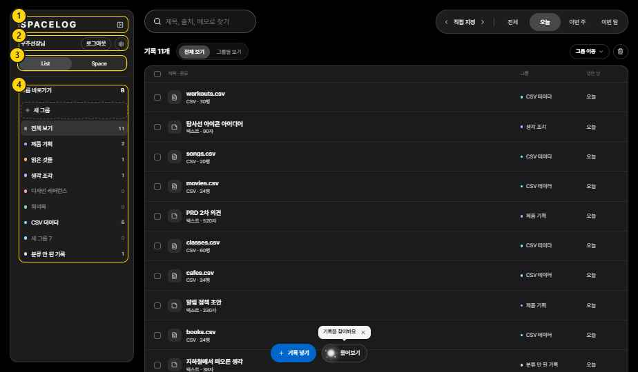

**[A] List 기본**

1. 로고 · 접기 버튼
2. 사용자 이름 · 로그아웃(F-26) · 설정(F-24)
3. 보기 전환 [List | Space] (F-02)
4. 그룹 바로가기: + 새 그룹 · 전체 보기 · 각 그룹 · 분류 안 된 기록(F-05). 이 영역만 스크롤

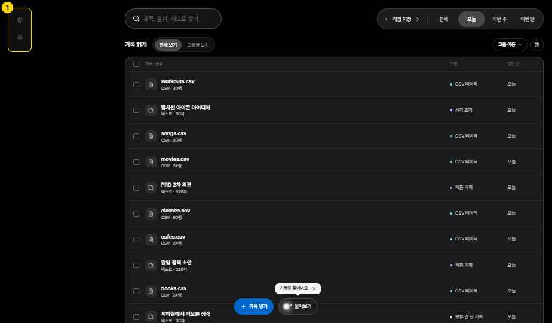

**[B] 접힌 상태**

1. 아이콘만 남은 세로 줄. 50%로 흐리고, 마우스를 올리면 100%

- **흐름:** 좌상단에 항상 떠 있습니다. 위에서부터 A① 로고 · 접기 / A② 사용자 이름 · 로그아웃 · 설정 / A③ [List | Space] / A④ 그룹 바로가기. Space에서는 맨 아래 ‘처음이라면 이렇게 날아요’가 더 있습니다(화면별 차이).
- **상태:** 펼침 / 접힘(아이콘만 남은 세로 줄) / 흐림(투명도 50%).
- **규칙·제한:**
  - 로고 ~ [List | Space] 아래 구분선까지는 고정, 그 아래만 스크롤.
  - 스크롤바는 숨깁니다. 더 내릴 내용이 있으면 아래 64px 그라데이션 + 가운데 `⌄` 버튼. 누르면 맨 아래로 이동.
  - 접힘 상태이거나, Space에서 그룹 창이 열려 있는 동안 50%로 흐립니다. 마우스를 올리면 100%. 그 밖에는 항상 100%.
  - 창을 열고 닫아도 가운데 화면이 좌우로 움직이지 않습니다.
- **예외:** 그룹이 많아 창 높이를 넘으면 창 안에서만 스크롤.
- **반응형:** 1100px 미만은 F-25(상단바 + 사이드바)로 바뀝니다.
- **문구:** `그룹 바로가기`, `처음이라면 이렇게 날아요`
- **미정:** 로그아웃·마이페이지는 동작 없음(시안).

> **화면별 차이 · List / Space**

| 항목 | List | Space |
| --- | --- | --- |
| ‘전체 보기’ 행 | 있음 | 없음 (C①) |
| 맨 아래 안내 | 없음 | ‘처음이라면 이렇게 날아요’ 접이식 안내 (C②) |
| 흐림(50%) | 접힘 상태일 때만 | 접힘 상태 + 그룹 창이 열린 동안 (F-10 A⑦) |
| 그룹을 누르면 | 가운데 목록이 그 그룹으로 걸러짐 (F-05 C) | 행성으로 날아가 그룹 창이 열림 (F-10) |

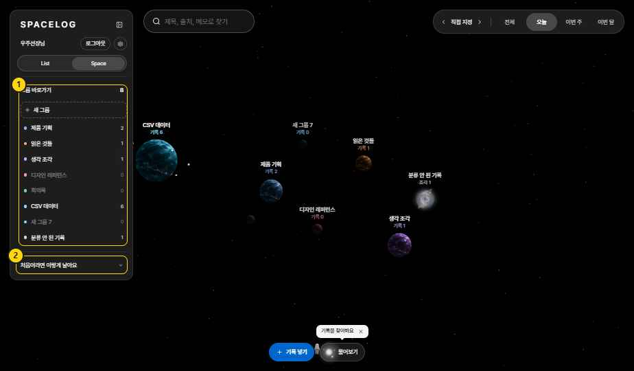

**[C] Space 목록 창**

1. 그룹 바로가기: ‘전체 보기’ 행이 없음
2. 처음이라면 이렇게 날아요: 누르면 이동 키 안내가 펼쳐짐

### F-02 보기 전환 (List / Space)

- **흐름:** 목록 창의 [List | Space] 스위치(F-01 A③)로 바꿉니다. 마지막 선택을 기억해 다음 진입 때 그대로 엽니다.
- **상태:** List / Space / Space 불러오는 중(검은 화면 + ‘불러오는 중’).
- **규칙·제한:** 보기를 바꿔도 기간, 선택한 그룹, 체크한 기록은 유지합니다.
- **예외:** Space 엔진을 못 불러오면 토스트 `Space 보기를 불러오지 못했어요` 후 List 유지.
- **반응형:** 모바일 사이드바에서 누르면 사이드바가 자동으로 닫힙니다.
- **문구:** `List`, `Space`
- **미정:** —

### F-03 기간 바

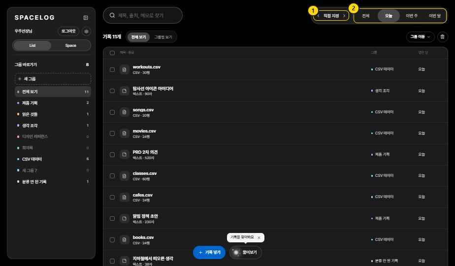

**[A] 기본**

1. ‹ 직접 지정 › — 가운데를 누르면 날짜 칸이 펼쳐지고, ‹ › 로 앞뒤 기간 이동
2. 기간 칩: 전체 · 오늘 · 이번 주 · 이번 달 (선택된 칩은 밝은 알약)

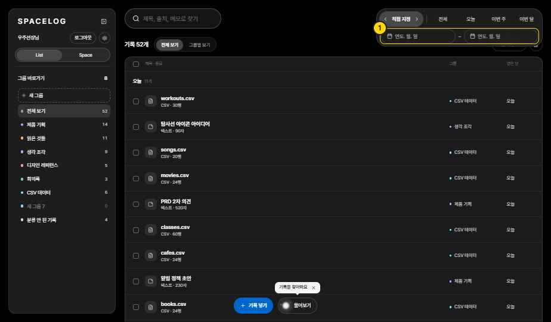

**[B] 직접 지정 펼침**

1. 시작일 – 종료일 날짜 칸. 누르면 달력

- **흐름:** 우상단. A① ‹ 직접 지정 › · A② 전체 · 오늘 · 이번 주 · 이번 달. 누르면 바로 목록·우주가 바뀝니다. 직접 지정을 누르면 아래에 B① 날짜 칸이 펼쳐집니다.
- **상태:** 기본 / 직접 지정 펼침(아래로 연·월·일 줄) / 숨김(Space에서 그룹 창이 열린 동안 사라짐).
- **규칙·제한:**
  - 칩 4개는 76px, 공간이 모자랄 때만 44px까지 줄어듭니다. ‘‹ 직접 지정 ›’은 줄지 않습니다.
  - 직접 지정을 누르거나 ‹ › 로 날짜를 바꿀 때 바의 위치와 크기가 흔들리지 않습니다.
  - 기록 상세를 연 채 기간을 바꾸면, 보던 기록이 새 기간에 없을 경우 그 기간의 첫 기록으로 바뀝니다.
- **예외:** 고른 기간에 기록이 0개면 빈 목록 안내(F-06 참고). 0-3의 ‘전체’ 토스트.
- **반응형:** 모바일 형식은 상단 시계 아이콘을 눌러야 나옵니다. 검색과 같은 자리라 하나를 열면 다른 하나는 닫힙니다.
- **문구:** `직접 지정`, `오늘`, `이번 주`, `이번 달`, `전체`
- **미정:** Search 시안의 달력 ‘적용’ 버튼은 v2에 아직 반영되지 않았습니다(지금은 고르면 바로 적용).

> **화면별 차이 · List / Space**

| 항목 | List | Space |
| --- | --- | --- |
| 위치·모양 | 우상단 | 같음 |
| 그룹 창이 열렸을 때 | (해당 없음) | 기간 바가 사라짐 (F-10 A 참고). 그룹 창 안의 기간 칩(F-10 A④)을 씀 |
| 모바일 | 상단바 시계 아이콘 → 기간 바 (F-25 D) | 같음 |

### F-04 검색

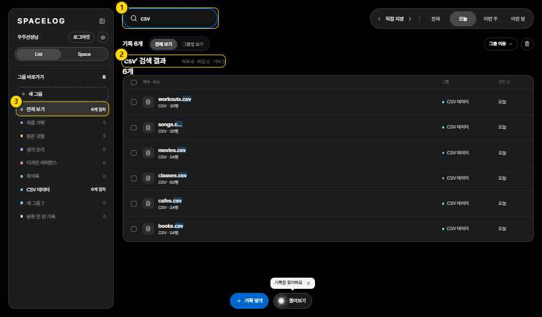

**[A] List 검색 결과**

1. 검색창. 입력 즉시 결과
2. 제목 줄 ‘검색어’ 검색 결과 n개 + 제목 · 메모 · 기타 일치 수
3. 목록 창 숫자가 ‘n개 일치’로 바뀌고, 일치 0개 그룹은 흐려짐

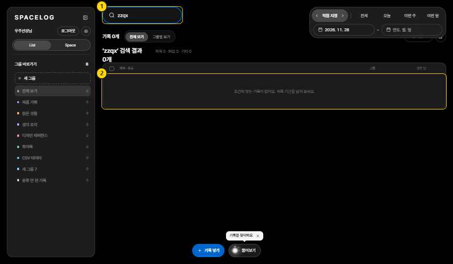

**[B] List 결과 없음**

1. 검색창
2. 빈 결과 안내 ‘조건에 맞는 기록이 없어요. 위쪽 기간을 넓혀 보세요.’

- **흐름:** 위에서 24px, 높이 44px 알약 A①. 입력하면 바로 결과로 바뀝니다.
- **상태:** 비어 있음 / 입력 중(결과 목록) / 결과 없음.
- **규칙·제한:**
  - List: 제목·출처·메모에서 찾습니다. 제목 줄 `‘검색어’ 검색 결과 n개`.
  - Space: 같은 자리·크기. 결과 목록에서 누르면 그 그룹으로 날아가 기록을 엽니다.
  - 검색도 지금 기간 안에서만 찾습니다.
- **예외:** 결과 0개 → `조건에 맞는 기록이 없어요. 위쪽 기간을 넓혀 보세요.` (B②). Space 결과 목록의 0개 안내는 확인 필요.
- **반응형:** 모바일 형식은 상단 검색 아이콘 → 기간 바 자리에 검색창이 나옵니다.
- **문구:** 자리 표시 글자는 화면 기준.
- **미정:** 검색 대상에 파일 본문(PDF 글자 등)을 넣을지.

> **화면별 차이 · List / Space**

| 항목 | List | Space |
| --- | --- | --- |
| 결과 표시 | 가운데 목록이 결과로 바뀜 (A②) | 검색창 아래 결과 목록이 펼쳐짐 (C②) |
| 결과를 누르면 | 같은 자리에서 기록 상세 (F-11) | 그 그룹으로 날아가 기록 상세 (F-10 B) |
| 검색창 안 | 검색어만 | 오른쪽에 ‘n개 · n개 그룹’과 × 지우기 (C①) |
| 목록 창 숫자 | ‘n개 일치’ (A③) | 같음 |

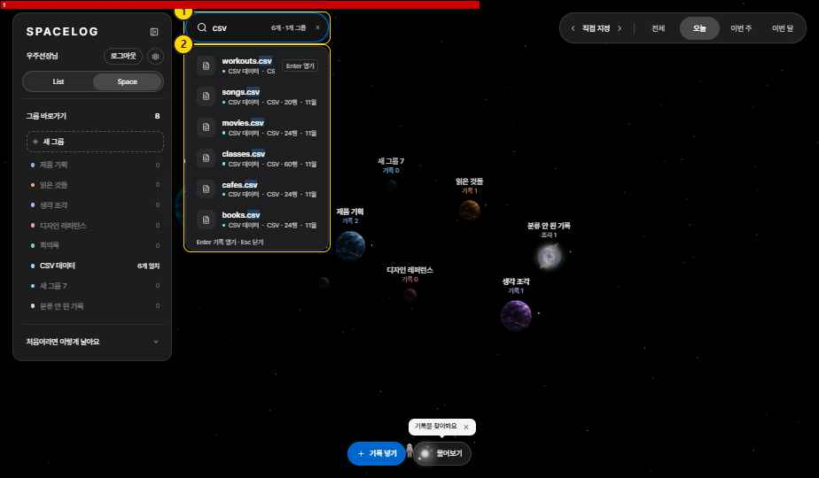

**[C] Space 검색 결과**

1. 검색창: 오른쪽에 ‘n개 · n개 그룹’, × 지우기
2. 결과 목록(그룹 · 종류 · 날짜). 누르거나 Enter → 열기, Esc 닫기

### F-05 그룹 관리

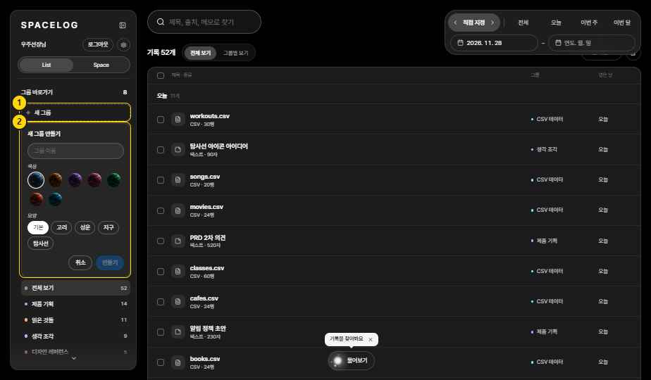

**[A] 새 그룹 만들기**

1. + 새 그룹
2. 새 그룹 만들기 창: 이름 · 색상 7가지 · 모양(기본 · 고리 · 성운 · 지구 · 탐사선) · 취소 / 만들기

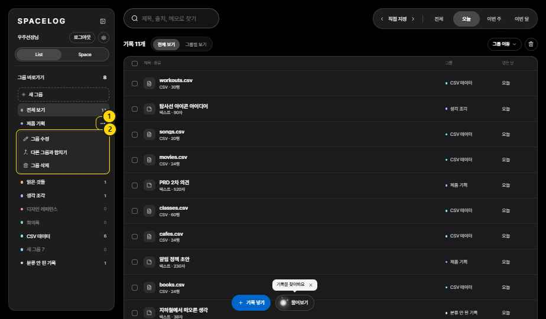

**[B] 그룹 메뉴**

1. 행에 마우스를 올리면 숫자 자리가 … 버튼
2. 그룹 수정 · 다른 그룹과 합치기 · 그룹 삭제

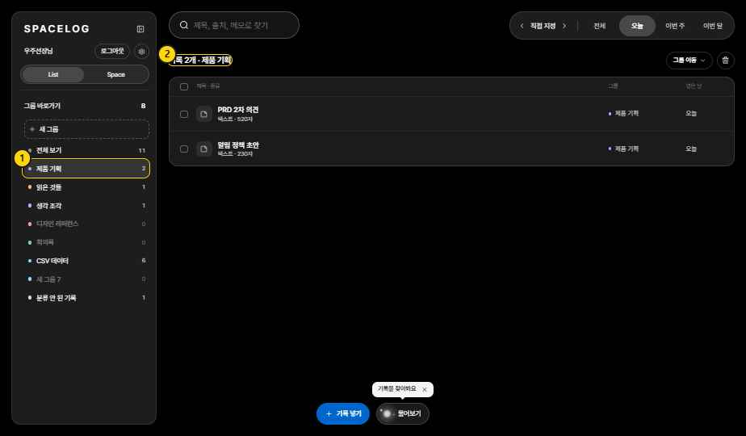

**[C] 그룹을 고른 상태**

1. 선택된 행(배경)
2. 목록 제목 ‘기록 n개 · 그룹 이름’

- **흐름:** 목록 창 ‘그룹 바로가기’ 아래 순서: A① + 새 그룹 · 전체 보기 · 각 그룹 · 분류 안 된 기록(맨 아래). 행에 마우스를 올리면 B① … 버튼, 누르면 B② 그룹 메뉴.
- **상태:** 기본 / 선택됨(행 배경) / 호버(숫자 자리가 `…` 버튼) / 이름 바꾸는 중 / 지우기 확인 / 기간 안 기록 0개(이름·숫자 40%).
- **규칙·제한:**
  - **새 그룹:** 누른 자리 바로 아래에 창이 열립니다. 이름, 색 7가지, 모양(기본·고리·성운·지구·탐사선) → `만들기`.
  - **이름 바꾸기:** 행이 입력칸으로 바뀝니다. Enter·칸 밖 클릭 저장, Esc 취소.
  - **지우기:** 기록이 있으면 확인 창 — `기록 n개를 다른 그룹으로 옮기고 지우기`(기본, 옮길 그룹 선택) / `기록 n개를 함께 지우기`. 빈 그룹은 ‘삭제’를 한 번 더 눌러 지웁니다.
  - ‘전체 보기’, ‘분류 안 된 기록’은 이름 바꾸기·삭제가 없습니다.
  - **다른 그룹과 합치기 (2026-11-28 결정):** 그룹 편집 → 그룹 합치기 → 합칠 대상 그룹 고르기 → 결과 안내 창에서 한 번 더 확인 → 메뉴를 연 그룹의 기록이 모두 대상 그룹으로 옮겨지고, 메뉴를 연 그룹은 삭제됩니다. ‘분류 안 된 기록’에는 이 메뉴가 없습니다(다른 그룹을 여기에 합치는 것은 가능).
- **예외:**
  - 같은 이름 → `같은 이름의 그룹이 이미 있어요`
  - 마지막 그룹을 지우려 하면 → `그룹은 하나는 남아 있어야 해요`
  - 이름이 비어 있으면 ‘만들기’가 동작하지 않습니다.
- **반응형:** 모바일은 그룹 행을 0.5초 꾹 누르면 이름 바꾸기 · 삭제 메뉴(터치·펜 전용).
- **문구:** `+ 새 그룹`, `전체 보기`, `분류 안 된 기록`, `새 그룹 만들기`
- **미정:** 그룹 최대 개수(정하지 않음). 그룹이 많을 때 접기 기준.

> **화면별 차이 · List / Space**

| 항목 | List | Space |
| --- | --- | --- |
| 그룹을 누르면 | 가운데 목록이 그 그룹으로 걸러짐 (C) | 행성으로 날아가 그룹 창이 열림 (F-10) |
| 그룹 메뉴 | 목록 창 행의 … (B) | 그룹 창 아래 ‘그룹 편집 …’ (D). 메뉴 항목은 같음 |

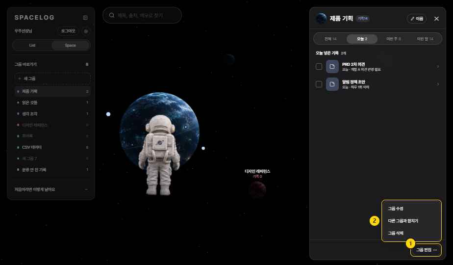

**[D] Space 그룹 메뉴**

1. 그룹 창 아래 ‘그룹 편집 …’
2. 그룹 수정 · 다른 그룹과 합치기 · 그룹 삭제

### F-06 List 목록

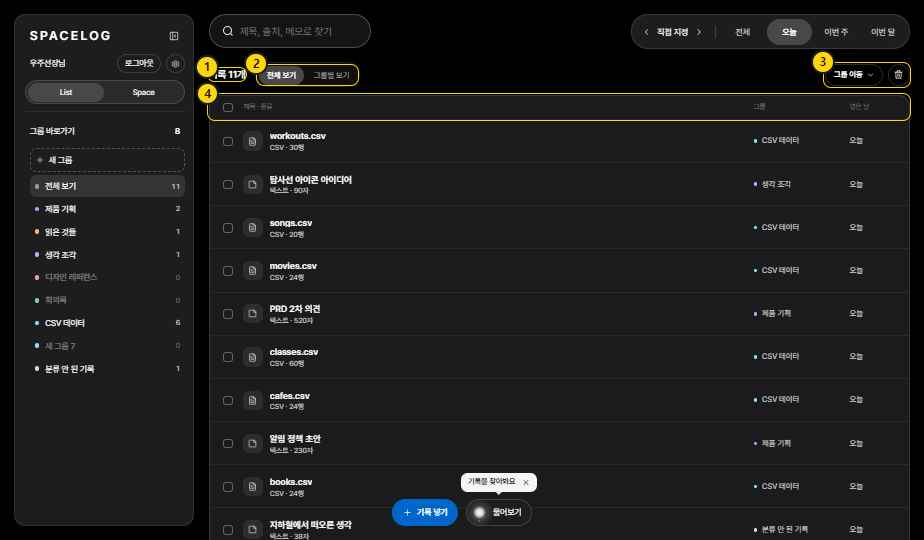

**[A] 전체 보기**

1. 기록 n개
2. [전체 보기 | 그룹별 보기]
3. 그룹 이동 · 휴지통 (F-07)
4. 머리줄: 전체 선택 · 제목·종류 · 그룹 · 넣은 날

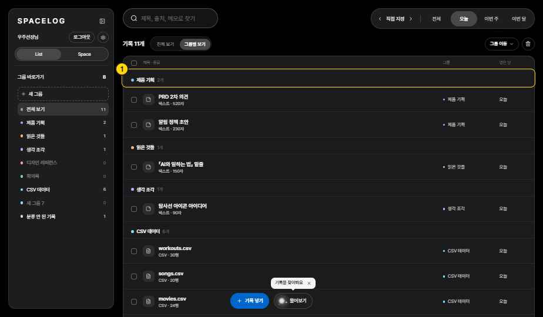

**[B] 그룹별 보기**

1. 그룹 머리줄(색 점 · 이름 · 개수)

- **흐름:** A① 기록 n개 + A② [전체 보기 | 그룹별 보기] + A③ 그룹 이동 · 휴지통 → 표 형태 목록(A④ 머리줄). 행을 누르면 같은 자리에서 기록 상세(F-11)로 바뀝니다(새 창 아님). List 전용이며, Space에서는 그룹 창 목록(F-10 A⑤)이 이 역할을 합니다.
- **상태:** 전체 보기 / 그룹별 보기 / 그룹 하나 선택 / 비어 있음 / 검색 중.
- **규칙·제한:**
  - 열: 체크 · 제목·종류 · 그룹(색 점 + 이름) · 넣은 날. ‘지난 날’ 열은 없습니다.
  - 정렬은 최근 넣은 순 하나(정렬 바꾸기 없음).
  - 기간이 ‘오늘’이면 목록 안 날짜 줄을 숨깁니다.
  - 그룹을 바꿔도 제목과 목록의 위치가 위아래로 움직이지 않습니다.
  - 페이지 전체가 스크롤됩니다(목록 카드 안 스크롤 없음).
- **예외:** 기간 안 기록 0개 → 빈 상태 안내 `끌어다 놓으면 기록이 됩니다.` / `클립보드에서 바로 붙여넣을 수도 있어요.`
- **오류·권한 (미정):** 목록을 불러오지 못하면 빈 상태 안내 대신 `기록을 불러오지 못했어요 · 다시 시도`(미정).
- **반응형:** 모바일은 목록 카드 안에서만 스크롤. 1줄 `기록 n개`, 2줄 `그룹별` 토글 · `그룹 이동` · 삭제.
- **문구:** `전체 보기`, `그룹별 보기`
- **미정:** 한 번에 불러올 개수와 더 불러오기 방식(프로토타입은 전부 표시).

### F-07 체크와 일괄 동작

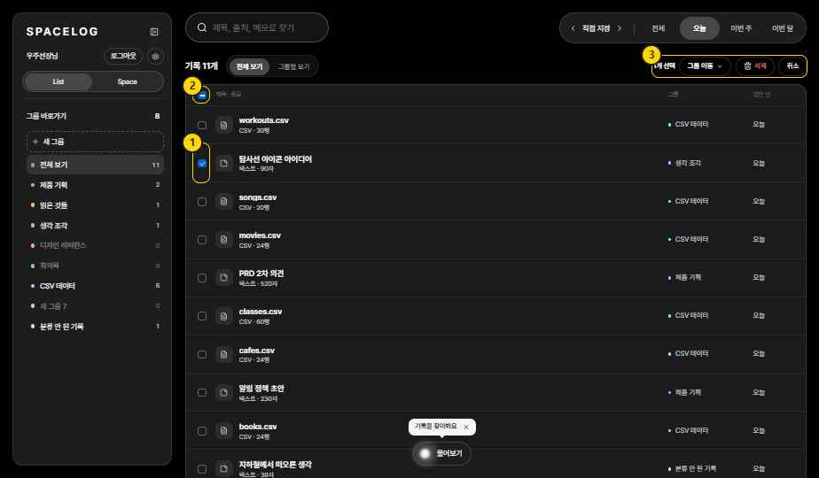

**[A] 체크한 상태**

1. 행 체크박스(항상 보임)
2. 전체 선택 칸(일부 선택이면 가로줄)
3. n개 선택 · 그룹 이동 · 삭제 · 취소

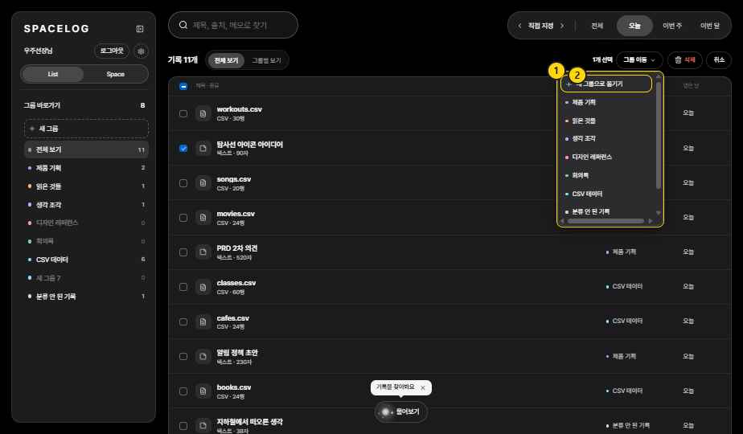

**[B] 그룹 이동 메뉴**

1. 그룹 이동 메뉴(넘치면 안에서 스크롤)
2. 새 그룹으로 옮기기(맨 위)

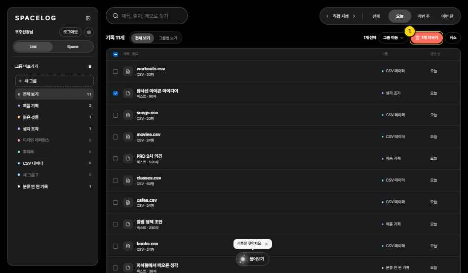

**[C] 삭제 확인**

1. 두 번째 누름: ‘n개 지우기’

- **흐름:** A① 행 맨 왼쪽 체크박스 → 목록 위 오른쪽 A③ n개 선택 · 그룹 이동 · 삭제 · 취소.
- **상태:** 선택 없음 / 일부 선택(전체 선택 칸에 가로줄) / 전체 선택.
- **규칙·제한:**
  - 체크박스는 항상 보입니다. 머리줄에 전체 선택 칸.
  - ‘그룹 이동’ 메뉴 맨 위(B②) `새 그룹으로 옮기기`.
  - 삭제는 두 번: `삭제` → `n개 지우기`.
  - 그룹이나 보기를 바꿔도 체크는 풀리지 않습니다.
  - 기록 상세에 들어가면 체크박스와 도구 줄을 숨깁니다.
- **예외:** 체크 없이 ‘그룹 이동’·‘삭제’ → 버튼 아래 말풍선 안내.
- **오류·권한 (미정):** 일부만 옮겨지거나 지워지면 성공한 개수를 알려 줍니다: `n개 중 n개를 옮겼어요`(미정).
- **반응형:** 모바일은 카드 맨 위 고정 줄에 전체 선택 · `n개 선택` · `취소`.
- **문구:** `그룹 이동`, `삭제`, `n개 지우기`, `취소`, `새 그룹으로 옮기기`
- **결정 (2026-11-28):** 휴지통·되살리기 없음. ‘삭제’ → ‘n개 지우기’를 한 번 더 누르면 DB·Qdrant·Storage에서 모두 지웁니다. 버튼 아이콘만 휴지통 모양입니다.

> **화면별 차이 · List / Space**

| 항목 | List | Space |
| --- | --- | --- |
| 도구 줄 위치 | 목록 위 오른쪽 (A③) | 그룹 창 아래 (D②) |
| 순서 · 문구 | n개 선택 · 그룹 이동 · 삭제 · 취소 | 그룹 이동 · 삭제 · n개 선택 · 선택 해제 |
| 전체 선택 칸 | 있음 (A②) | 없음 |

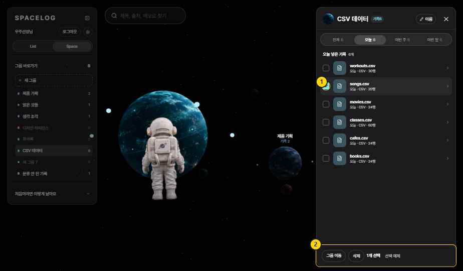

**[D] Space 그룹 창에서 체크**

1. 그룹 창 행 체크박스
2. 그룹 창 아래 도구 줄

### F-08 분류 안 된 기록 카드

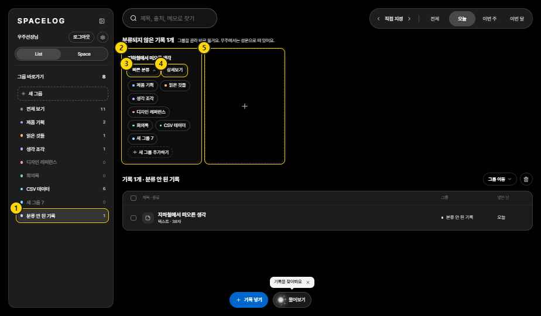

**[A] ‘분류 안 된 기록’을 고른 List**

1. 목록 창 ‘분류 안 된 기록’
2. 기록 카드
3. 빠른 분류 ⌄ — 펼치면 그룹 버튼 + 새 그룹 추가하기
4. 상세보기
5. + 칸: 분류 안 된 기록으로 넣기 (F-17)

- **흐름:** A① ‘분류 안 된 기록’ 그룹에 들어갔을 때만 목록 위에 A② 카드로 보입니다. 카드마다 제목 · A③ 빠른 분류 ⌄ · A④ 상세보기. 맨 끝 A⑤ + 칸으로 바로 넣을 수 있습니다.
- **상태:** 접힘 / 빠른 분류 펼침(그룹 버튼들 + `+ 새 그룹 추가하기`).
- **규칙·제한:** 그룹 버튼을 누르면 바로 옮기고 카드가 목록에서 빠집니다.
- **예외:** 분류 안 된 기록이 0개면 카드 영역 없음.
- **반응형:** —
- **문구:** `빠른 분류`, `상세보기`, `+ 새 그룹 추가하기`
- **미정:** —

> **화면별 차이 · List / Space**

| 항목 | List | Space |
| --- | --- | --- |
| 모양 | 카드 + 아래 표 목록 (A) | 성운 행성 + 그룹 창 목록 (B) |
| 숫자 단위 | 기록 n | 조각 n (B①) |
| 안내 문구 | 제목 옆 한 줄 | 그룹 창 맨 위 점선 상자 (B②) |
| 빠른 분류 | 있음 (A③) | 없음. 체크 후 그룹 이동(F-07) |

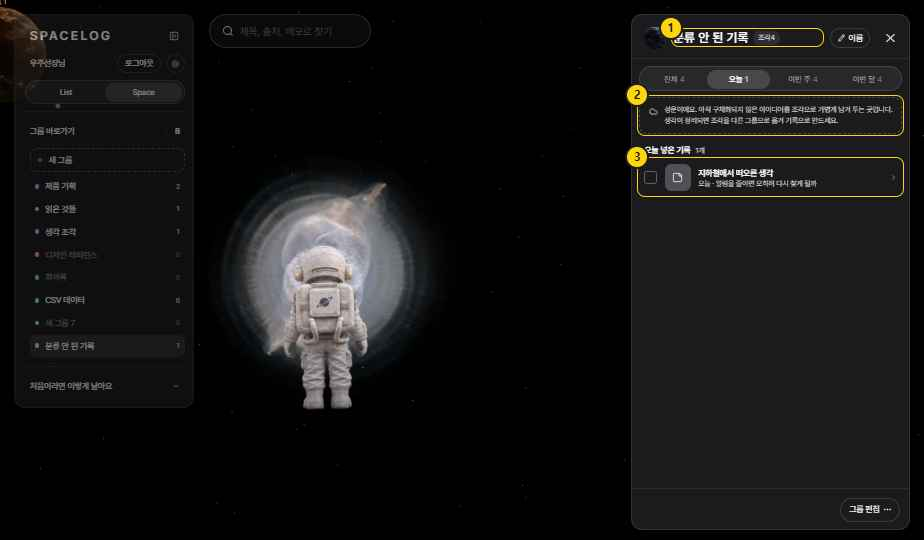

**[B] Space ‘분류 안 된 기록’**

1. 그룹 이름 + ‘조각 n’
2. 성운 안내 문구
3. 기록 목록(빠른 분류 없음)

### F-09 Space 보기

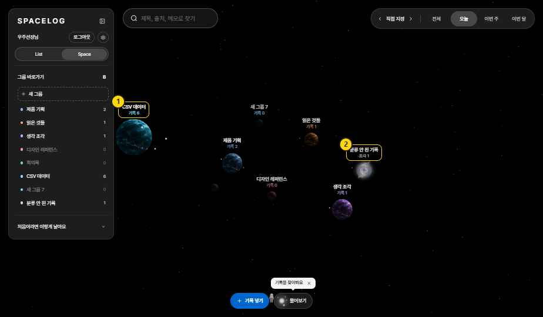

**Space 둘러보기**

1. 행성 이름표: 그룹 이름 · 기록 n
2. 분류 안 된 기록 = 성운, ‘조각 n’

- **흐름:** 그룹 = 행성. 행성(①)을 누르면 날아가 착륙(약 800ms) → 오른쪽에 그룹 창(F-10).
- **상태:** 둘러보기 / 그룹 선택(나머지 행성 55% 밝기) / 기록 상세 열림.
- **규칙·제한:**
  - 행성 위에 이름표(그룹 이름 · `기록 n`, 분류 안 된 기록은 `조각 n`).
  - 이름표가 다른 행성·이름표·캐릭터·창과 겹치면 숨깁니다.
  - 우주인 캐릭터(실사 PNG, 방향별 이미지). 정면 이동은 몸을 틀지 않고, 대각선 이동만 기울입니다.
  - 이동: 방향키, Space 상승, Shift 하강, 드래그 시점, 휠 앞뒤, E 착륙.
  - 빈 공간을 누르면 열린 창을 닫습니다(드래그·휠은 닫지 않음).
  - 상세 창이 열려 있어도 목록 창에서 다른 그룹으로 바로 이동할 수 있습니다.
- **예외:** 엔진을 못 불러오면 F-02 예외.
- **반응형:** 모바일은 이동 키 안내를 숨깁니다.
- **문구:** `처음이라면 이렇게 날아요` 안의 이동 안내.
- **미정:** 배경 음악은 지금 끔(코드 제거). 위치 편집·블랙홀은 숨김(4절).

### F-10 그룹 창 (Space)

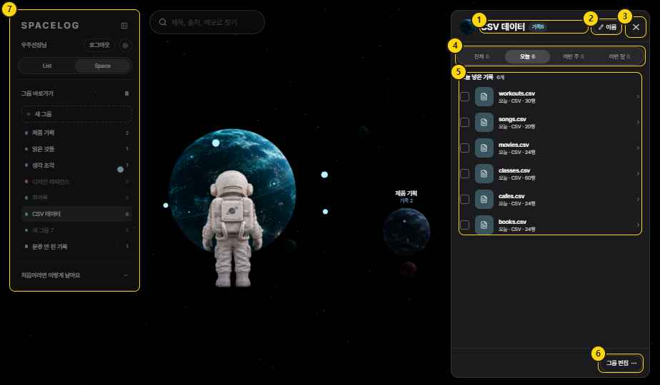

**[A] 그룹 창**

1. 그룹 이름 · 기록 n
2. 이름 바꾸기
3. 닫기(조망으로 돌아가기)
4. 기간 칩: 전체 · 오늘 · 이번 주 · 이번 달 (칩마다 개수)
5. 기록 목록(체크박스 · 종류 아이콘 · 제목 · 날짜·종류·크기)
6. 그룹 편집 … (F-05 D)
7. 목록 창 50% 흐림(마우스를 올리면 100%)

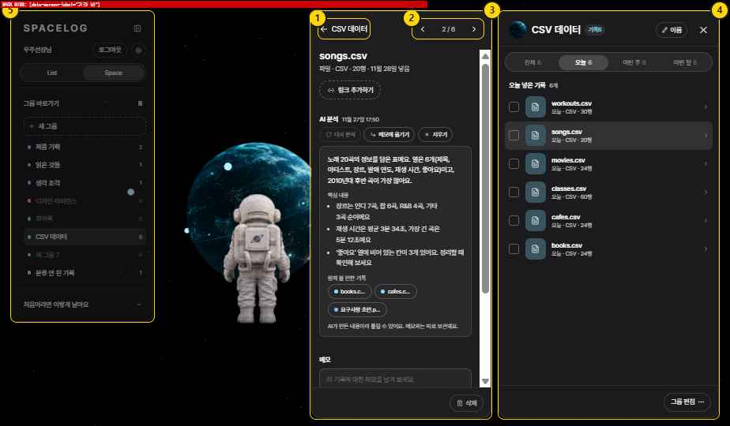

**[B] 기록 상세 함께 열림**

1. ← 그룹 이름(상세 닫기)
2. ‹ n / n ›
3. 기록 상세 창(그룹 창 왼쪽, F-11)
4. 그룹 창 유지. 보고 있는 행 강조
5. 목록 창 흐림 유지

- **흐름:** 오른쪽 창. A① 그룹 이름 · A④ 기간 칩 · A⑤ 기록 목록. 기록을 누르면 왼쪽에 B③ 상세가 함께 열립니다(그룹 창 유지). 그룹 창이 열린 동안 기간 바와 검색창은 숨기고, 목록 창은 50%로 흐립니다(A⑦).
- **상태:** 목록 / 체크 중 / 비어 있음 / 상세 함께 열림.
- **규칙·제한:**
  - 폭 464px(검색바와 16px 간격).
  - 체크하면 아래 `그룹 이동 · 삭제 · n개 선택 · 선택 해제`(F-07 D).
  - 그룹 메뉴 `그룹 편집`: 이름, 색, 모양을 바꾸면 저장 전에 미리 보이고, 저장하지 않으면 원래대로.
- **예외:** 기간 안 기록이 0개 → 끌어다 놓기 영역 + `기록 추가하기`.
- **반응형:** 760px 미만은 좌우·아래 여백 없이 가득, 위쪽 모서리만 둥글게.
- **문구:** `그룹 편집`, `기록 추가하기`
- **미정:** —

### F-11 기록 상세

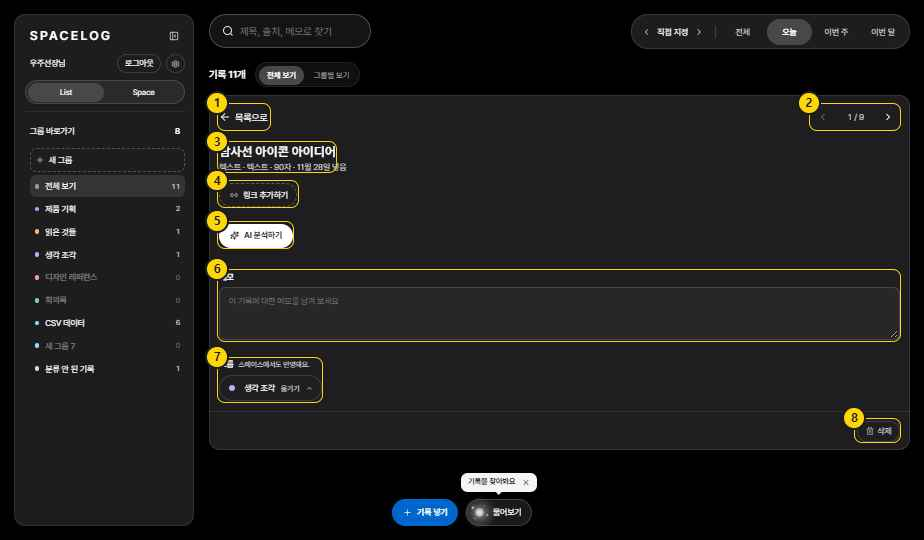

**[A] List 기록 상세**

1. ← 목록으로
2. ‹ n / n ›
3. 제목 · 종류·크기·넣은 날
4. 링크 추가하기 (B)
5. AI 분석하기 (F-14)
6. 메모 (F-12)
7. 그룹 · 옮기기 (F-13)
8. 삭제 (F-16)

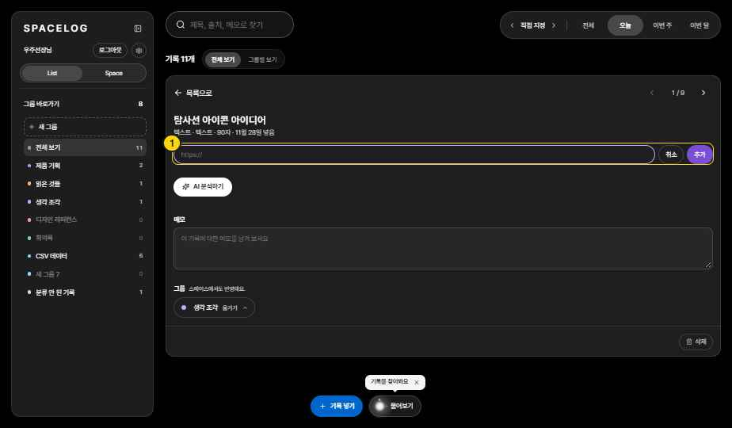

**[B] 링크 추가하기**

1. 주소 칸 · 취소 · 추가

- **흐름:** 머리줄 A① ← 목록으로 · A② ‹ n / n › → A③ 제목 · 종류·크기·넣은 날 → 미리보기 → A④ 링크 → A⑤ AI 분석(F-14) → A⑥ 메모(F-12) → A⑦ 그룹(F-13) → A⑧ 삭제(F-16).
- **상태:** 기본 / 다른 기록에서 넘어옴(F-15 띠) / 삭제 확인.
- **규칙·제한:**
  - `‹ ›` 는 같은 그룹 안에서 넣은 순서로 이동합니다. 넘어간 기록이 지금 기간 밖이면 기간을 자동으로 넓힙니다(오늘 → 이번 주 → 이번 달 → 전체).
  - 미리보기: 이미지·파일은 썸네일을 보여 줍니다. **텍스트 기록은 미리보기를 보여 주지 않습니다**(메모와 같은 내용이 두 번 보이지 않게).
  - 보여 줄 내용이 없는 미리보기 자리는 숨깁니다.
  - 링크: 있으면 `링크 열기 (도메인)`, 없으면 점선 `링크 추가하기` → 입력칸 · `취소` · `추가`.
  - 넣은 날이 오늘이 아니면 날짜를 그룹 색으로 표시합니다(리마인드에서 열었을 때 헷갈리지 않게).
- **예외:** 보던 기록이 다른 곳에서 지워지면 목록으로 돌아갑니다.
- **오류·권한:** 이미지·파일을 못 불러오면 미리보기 자리를 숨기고 종류·크기만 보입니다.
- **반응형:** List는 창 안 스크롤 없이 페이지가 길어집니다. Space는 창 안 스크롤. 760px 미만은 화면 가득.
- **문구:** `← 목록으로`, `링크 열기`, `링크 추가하기`
- **미정:** 링크 주소 형식 검사(지금은 그대로 저장).

> **화면별 차이 · List / Space**

| 항목 | List | Space |
| --- | --- | --- |
| 열리는 곳 | 목록 자리에서 바뀜 (A) | 그룹 창 왼쪽 별도 창 (C③) |
| 머리줄 왼쪽 | ← 목록으로 (A①) | ← 그룹 이름 (C①) |
| 옆 화면 | 목록 창만 보임 | 그룹 창이 오른쪽에 그대로 (F-10 B④) |
| 내용 구성 | A③ ~ A⑧ | 같음 |


**[C] Space 기록 상세**

1. ← 그룹 이름
2. ‹ n / n ›
3. 별도 창(그룹 창 왼쪽)
4. 그룹 창은 오른쪽에 그대로
5. 목록 창 흐림 유지

### F-12 메모

- **흐름:** 상세 안 ‘메모’ 칸(F-11 A⑥)에 바로 씁니다.
- **상태:** 비어 있음 / 쓰는 중 / `저장 중…` / `자동 저장됨`.
- **규칙·제한:** 입력을 멈추고 0.7초 뒤, 칸 밖 클릭, 다른 기록으로 이동, 창 닫기 때 자동 저장합니다. 저장·수정 버튼은 없습니다.
- **예외:** 저장 실패 처리는 프로토타입에 없습니다(미정).
- **오류·권한 (미정):** 저장 실패 시 상태 글자를 `저장하지 못했어요 · 다시 시도`로 바꾸고, 쓴 내용은 지우지 않습니다(제안).
- **반응형:** —
- **문구:** 자리 표시 `이 기록에 대한 메모를 남겨 보세요`
- **미정:** 메모 최대 길이. 저장 실패 시 안내 문구.

### F-13 기록의 그룹 바꾸기

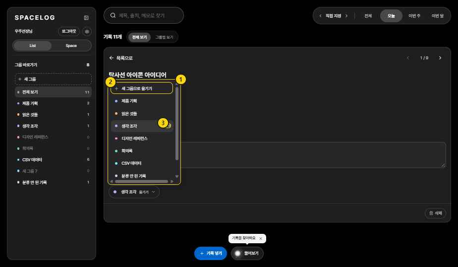

**[A] 그룹 목록 펼침**

1. 위로 펼쳐지는 그룹 목록(넘치면 안에서 스크롤)
2. + 새 그룹으로 옮기기
3. 지금 그룹(‘현재’ 표시)

- **흐름:** 상세 아래 ‘그룹’ 버튼(F-11 A⑦) → 위로 펼쳐지는 ① 목록에서 고릅니다.
- **상태:** 닫힘 / 펼침 / 새 그룹 만들기 창.
- **규칙·제한:**
  - 목록 최대 높이 350px(약 8줄), 넘으면 안에서 스크롤.
  - 맨 위 `+ 새 그룹으로 옮기기` → 이름 · 색 7가지 · 모양 → `만들고 옮기기`.
  - 옆 안내: `스페이스에서도 반영돼요.`
  - 기록이 ‘분류 안 된 기록’에 있으면 그룹 버튼 옆에 `AI 추천`. 누르면 `AI 추천 중` + 점 3개 → 그룹 목록이 펼쳐지고 추천 그룹에 `✦ AI 추천` 뱃지. 자동으로 옮기지 않고 사용자가 골라 옮깁니다. 재료는 자동 가공에서 뽑은 글자 + 메모 + 기존 그룹입니다 (2026-11-28 결정, 시안 v3).
- **예외:** 같은 이름 → `같은 이름의 그룹이 이미 있어요`. AI 추천 실패·알맞은 그룹 없음 → `알맞은 그룹을 찾지 못했어요. 직접 골라 주세요.` AI 활용 꺼짐 그룹(F-23)의 기록 → `AI 추천` 비활성, `AI를 활용한 기록 수집이 꺼져 있는 그룹이에요. 챗봇 설정에서 켤 수 있어요.`
- **반응형:** PC·모바일 모두 위로 펼침.
- **문구:** `옮기기`, `+ 새 그룹으로 옮기기`, `만들고 옮기기`, `AI 추천`, `AI 추천 중`, `✦ AI 추천`
- **미정:** —

### F-14 AI 분석

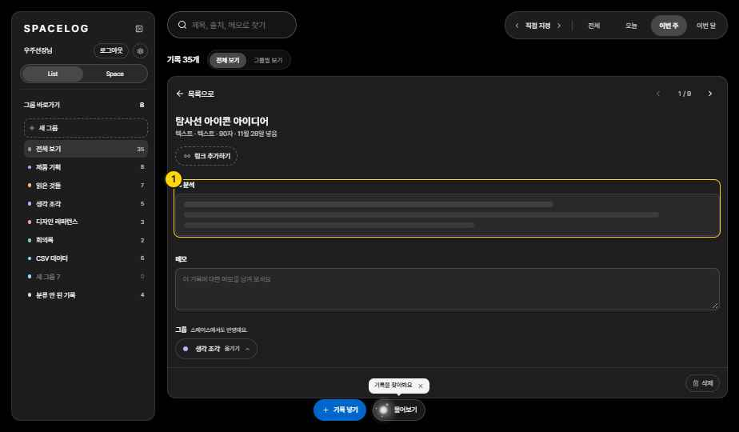

**[A] 분석 중**

1. ‘AI 분석’ 자리 표시(회색 줄)

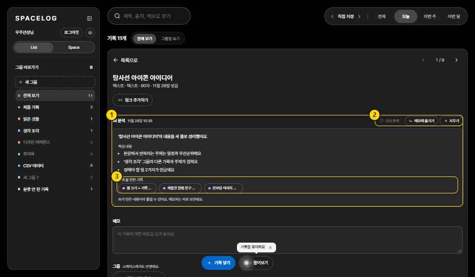

**[B] 분석 결과**

1. AI 분석 영역: 분석 시각 · 핵심 1줄 · 요약 3개
2. 다시 분석 · 메모에 옮기기 · 지우기. 지우기는 3초 안에 한 번 더 눌러야 지워짐(‘한 번 더 누르면 지워요’)
3. 함께 볼 만한 기록 (F-15)

- **흐름:** `링크 추가하기` 아래 흰 버튼 ✦ AI 분석하기(F-11 A⑤) → A① 자리 표시(약 1.1초) → 링크와 메모 사이에 B① ‘AI 분석’ 영역이 생기고 버튼은 사라집니다.
- **상태:** 분석 전 / 분석 중 / 결과 있음.
- **규칙·제한:**
  - 결과: 파일 내용과 메모를 바탕으로 한 **핵심 1줄 + 요약 3개**와 분석 시각. 보고서 형식은 쓰지 않습니다.
  - 함께 볼 만한 기록: 프로토타입은 같은 그룹 2개 + 같은 종류 1개. 실제로는 AI API로 만든 요약본 벡터의 유사도 0.8 이상 상위 3개를 볼 때 계산합니다(2026-11-28 결정).
  - 오른쪽 위 `다시 분석` · `메모에 옮기기` · `지우기`.
  - `다시 분석`은 마지막 분석 뒤 메모에 새로 쓴 글자가 10자 이상(공백 제외)일 때만 켜집니다. `메모에 옮기기`로 덧붙인 글은 세지 않습니다. 꺼져 있을 때 누르면 `메모에 10자 이상 새로 쓰면 다시 분석할 수 있어요 (지금 n자)` (2026-11-28 결정).
  - AI 활용 꺼짐 그룹(F-23에서 체크한 그룹)의 기록은 `AI 분석하기`·`다시 분석`이 비활성: `AI를 활용한 기록 수집이 꺼져 있는 그룹이에요. 챗봇 설정에서 켤 수 있어요.`
  - `메모에 옮기기`: 기존 메모 아래에 빈 줄 하나를 두고 덧붙입니다(덮어쓰지 않음).
  - 결과는 기록마다 저장되어 다시 열어도 남습니다.
  - 분석 중 다른 기록으로 넘어가면 결과를 원래 기록에 붙이지 않고 버립니다.
- **예외:** 분석 실패 → `분석하지 못했어요. 잠시 후 다시 시도해 주세요.` + `다시 시도`. 지원하지 않는 파일, 너무 큰 파일 → 안내 문구 미정.
- **오류·권한 (미정):** 실패해도 기존 결과는 지우지 않습니다. 로그인 전에는 버튼을 누르면 로그인 창.
- **반응형:** PC 높이 40px·내용 폭, 모바일 높이 44px·화면 폭.
- **문구:** `AI 분석하기`, `분석 중…`, `다시 분석`, `메모에 옮기기`, `지우기`, `다시 시도`, `AI가 만든 내용이라 틀릴 수 있어요. 메모와는 따로 보관돼요.`
- **미정 · 프로토타입 한정:** **지금 결과는 기록 종류(CSV / 이미지 / 링크 / 그 밖)별로 정해 둔 예시 문장입니다.** 실제 AI 연결, 분석 대상(파일 본문 읽기 범위), 비용·횟수 제한, 오류 문구를 정해야 합니다. ‘함께 볼 만한 기록’을 결과에 남길지 정해야 합니다.

### F-15 함께 볼 만한 기록 · 돌아가기

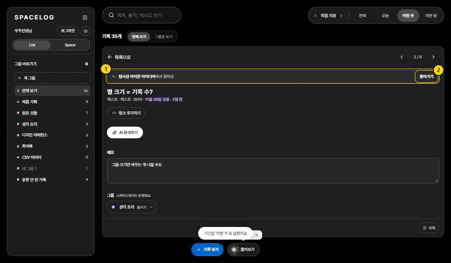

**돌아가기 띠**

1. 띠 ‘○○에서 왔어요’
2. 돌아가기

- **흐름:** AI 분석의 ‘함께 볼 만한 기록’(F-14 B③)을 누르면 그 기록 상세로 넘어갑니다. 제목 위에 ① 띠가 생기고, ② 돌아가기(띠 어디를 눌러도 됨)로 원래 기록으로 돌아갑니다.
- **상태:** 띠 없음 / 띠 있음.
- **규칙·제한:**
  - 여러 번 넘어가면 지나온 기록이 쌓이고, 누를 때마다 한 단계씩 돌아갑니다.
  - `‹ ›` 로 이웃 기록으로 넘기면 띠가 사라집니다(쌓지 않음).
  - 상세 창을 닫으면 쌓인 기록을 비웁니다.
- **예외:** 원래 기록이 지워졌으면 띠를 보이지 않습니다.
- **반응형:** —
- **문구:** `○○에서 왔어요`, `돌아가기`
- **미정:** 머리줄 `←` 도 직전 기록으로 돌아가게 할지(제안 1번, 아직 반영 안 함).

### F-16 기록 삭제

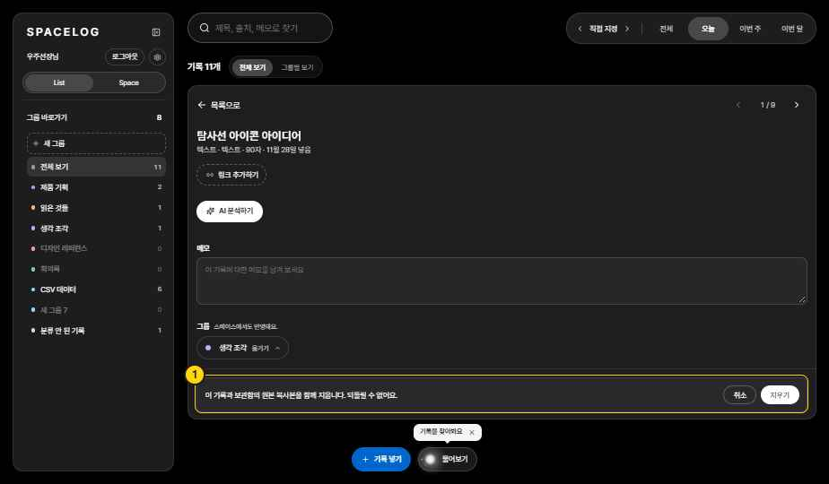

**[A] 삭제 확인**

1. ‘이 기록과 보관함의 원본 복사본을 함께 지웁니다. 되돌릴 수 없어요.’ · 취소 · 지우기

- **흐름:** 상세 맨 아래 삭제(F-11 A⑧) → 같은 줄에 ① 안내 + 취소 · 지우기.
- **규칙·제한:** 지우면 목록으로 돌아가고 토스트.
- **예외:** —
- **오류·권한 (미정):** 삭제 실패 시 기록을 그대로 두고 0-7 저장 실패 처리.
- **결정 (2026-11-28):** 되살리기 없음(휴지통 없음).

### F-17 기록 넣기

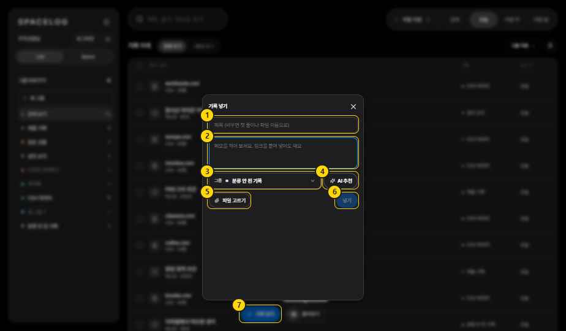

**기록 넣기 창**

1. 제목(비우면 첫 줄이나 파일 이름)
2. 메모(링크를 붙여 넣어도 됨)
3. 그룹 선택
4. AI 추천 (시안 v3에서 삭제. 기록 상세 F-13에서 추천)
5. 파일 고르기
6. 넣기
7. + 기록 넣기 버튼(다시 누르면 닫힘)

- **흐름:** 하단 가운데 ⑦ + 기록 넣기 → 창(아래에서 84px, 폭 440px, 높이 560px). 화면 어디에 끌어다 놓거나 붙여넣어도 이 창이 열립니다.
- **상태:** 비어 있음 / 파일 고름(아직 넣지 않음) / 제목·메모 입력 / 넣는 중.
- **규칙·제한:**
  - 파일을 골라도 **바로 넣지 않습니다.** 고른 파일은 빼기(X)가 가능하고, `넣기`나 Enter로 넣습니다.
  - 제목 칸이 있습니다. 비워 두면 파일 이름을 씁니다.
  - 메모만 써서 넣을 수 있습니다(텍스트 기록).
  - 그룹 선택 줄: 기본값은 ‘분류 안 된 기록’. 직접 고릅니다. 저장 창에는 AI 추천이 없습니다 (2026-11-28 결정, 기록 상세 F-13에서 추천).
  - 창이 열려 있어도 버튼은 그대로 있고, 다시 누르면 닫힙니다. 바깥 덮개를 눌러도 닫힙니다.
  - Enter 넣기, Shift+Enter 줄바꿈.
- **예외:** 챗봇 창 안의 요소를 끌어다 놓는 것은 기록으로 받지 않습니다. 파일 크기·형식 제한은 미정.
- **오류·권한 (미정):** 넣기 실패 시 창을 닫지 않고 고른 파일·제목·메모를 남기고 토스트 `기록을 저장하지 못했어요. 넣은 내용은 그대로 있어요.` 로그인 전에는 로그인 창.
- **반응형:** 760px 미만은 전체 화면 페이지.
- **문구:** `끌어다 놓으면 기록이 됩니다.`, `클립보드에서 바로 붙여넣을 수도 있어요.`
- **미정 · 프로토타입 한정:** 파일 최대 크기, 한 번에 넣을 수 있는 개수.

### F-18 물어보기 버튼

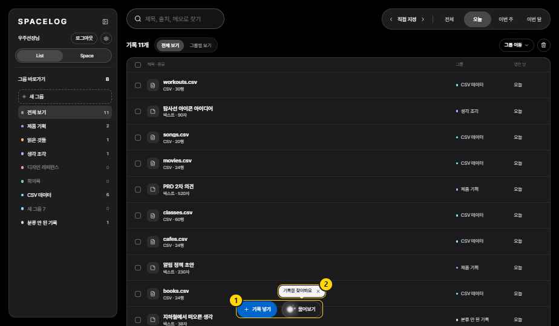

**하단 버튼 세트**

1. + 기록 넣기 · 물어보기
2. 말풍선 ‘기록을 찾아봐요’ · × 닫기

- **흐름:** ‘기록 넣기’ 오른쪽에 붙어 한 세트로 가운데 정렬(①). 누르면 챗봇 창(F-19).
- **규칙·제한:** 끌어서 옮길 수 있고 위치를 기억합니다. 항상 떠 있습니다. 버튼 위 말풍선(②, × 로 닫으면 다시 뜨지 않음) `기록을 찾아봐요`.
- **반응형:** 모바일 사이드바가 열린 동안 숨김.
- **문구:** `물어보기`, `기록을 찾아봐요`

### F-19 챗봇 창

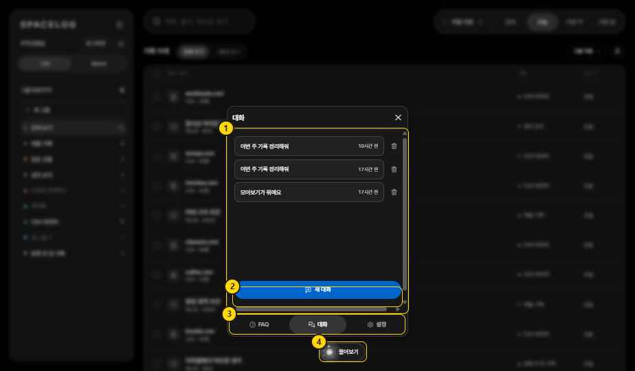

**[A] 대화 목록**

1. 대화 목록(제목 · 시간 · 지우기)
2. 새 대화
3. 아래 탭: FAQ · 대화 · 설정
4. 물어보기 버튼(다시 누르면 닫힘)

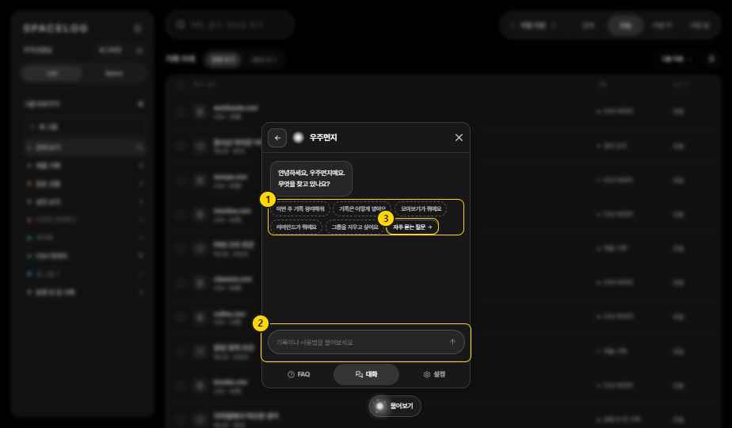

**[B] 새 대화**

1. 추천 질문 칩
2. 입력창
3. 자주 묻는 질문 → (F-22)

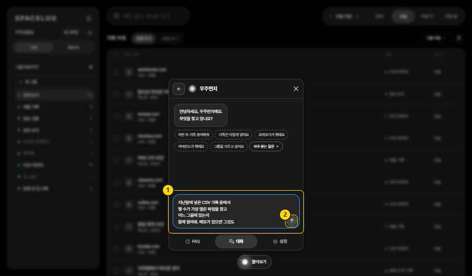

**[C] 입력창이 늘어난 상태**

1. 입력창(최대 4줄)
2. 보내기 버튼(글이 있을 때)

- **흐름:** 아래 탭 A③ FAQ · 대화 · 설정. 대화가 있었으면 A① 대화 목록부터, 없으면 바로 B 새 대화.
- **상태:** 대화 목록 / 대화 중 / 답 기다리는 중 / 자주 묻는 질문 펼침.
- **규칙·제한:**
  - 폭 440px(1100px 미만 400px), 아래에서 84px. 창을 띄워도 하단 버튼과 겹치지 않습니다.
  - 추천 질문 칩: 처음 5개, 대화 뒤 4개. 이미 물은 질문은 빠집니다. 맨 앞 `이번 주 기록 정리해줘`.
  - **입력창:** 한 줄 52px에서 글에 맞춰 최대 4줄(112px)까지 늘어납니다. 넘으면 안에서 스크롤(스크롤바 숨김). 두 줄부터 모서리 22px.
  - **보내기 버튼:** 비어 있으면 배경 없는 흐린 화살표(40%), 글이 있으면 옅은 회색 원 + 흰 화살표.
  - **흰색 강조는 내 질문 말풍선 한 곳만.** 선택된 탭은 옅은 회색 알약 + 흰 글자.
  - 창을 닫으면 대화를 목록에 저장합니다.
- **예외:** 빈 입력은 보내지 않습니다. 모르는 질문 → `거기까지는 아직 떠다녀 보지 못했어요.`
- **반응형:** 760px 미만은 전체 화면 페이지.
- **문구:** 탭 `홈`, `대화`, `설정`. 첫 인사 `안녕하세요, 우주먼지예요. 무엇을 찾고 있나요?`
- **미정 · 프로토타입 한정:** 답은 정해진 문구 + 기록 제목 찾기 규칙입니다. 실제 AI 연결 필요.
- **미정:** 첫 탭 이름. v2 화면은 ‘FAQ’, 기획 의도는 ‘홈’.

### F-20 챗봇 답

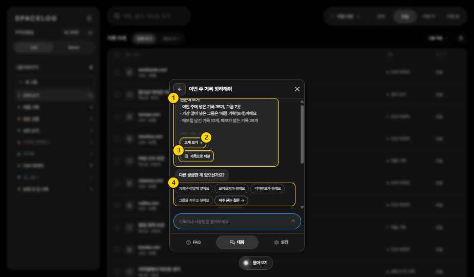

**챗봇 답**

1. 답 말풍선(긴 답은 아래가 흐려짐)
2. 새 창으로 보기 → (F-21)
3. 기록으로 저장
4. 이어지는 추천 질문

- **흐름:** ① 답 말풍선 → (출처 기록 카드) → ③ 기록으로 저장 → (화면 안내 버튼) → ④ 이어지는 추천 질문.
- **규칙·제한:**
  - 답 형식: 파일 내용과 메모를 바탕으로 **핵심 1줄 + 요약 3개**. 기록 상세 AI 분석(F-14)과 같습니다. 묶음 분석(예: `이번 주 기록 분석해줘`)은 보고서로 답하고 새 창(F-21)에서 봅니다.
  - 출처 카드를 누르면 그 기록 상세로 이동합니다.
  - `기록으로 저장` → ‘분류 안 된 기록’으로 저장, 버튼이 `기록으로 저장됨`. 다시 누르면 저장 취소.
  - 답이 화면의 버튼을 가리키면 우주먼지가 그 버튼 옆으로 날아가 안내합니다(챗봇 창에 가려지면 날아가지 않음).
  - 바로가기 버튼: 해당하면 `기록으로 저장`과 같은 줄에 `기록 넣기 열기` · `검색창으로 가기` · `이번 주 기록 보기` · `전체 기간으로 보기` · `챗봇 설정 바로가기`.
  - 찾는 기록이 없으면 `찾는 기록을 찾지 못했어요. 그룹별 AI 기록 수집 기능이 꺼져 있으면 기록이 수집되지 않을 수 있으니 확인해 주세요.` AI 활용 꺼짐 그룹이 있으면 `지금 꺼져 있는 그룹: ‘그룹 이름’, …`과 `챗봇 설정 바로가기`를 붙입니다.
- **문구:** `기록으로 저장`, `기록으로 저장됨`, `저장을 취소했어요`

### F-21 긴 답 새 창으로 보기

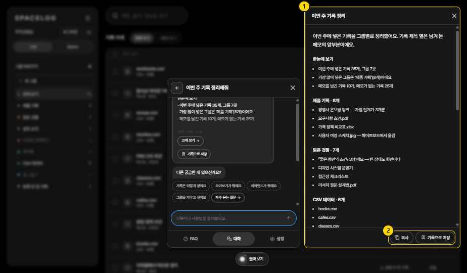

**읽기 화면(넓은 PC, v2 캡처)**

1. 읽기 화면: 제목 · 소개 · 소제목별 목록. 챗봇 창 옆 패널
2. 복사 · 기록으로 저장

- **흐름:** 긴 답은 말풍선에서 196px까지만 보이고 아래가 흐려지며 `새 창으로 보기` →(F-20 ②). 누르면 챗봇과 같은 크기의 요약 창(핵심 1줄 + 요약 3개) → `전체 보고서 보기`로 넓은 창(① 전체 보고서) → `‹ 요약으로`로 요약 창에 돌아옵니다 (시안 v3).
- **상태:** 닫힘 / 요약 창 / 전체 보고서.
- **규칙·제한:**
  - 전체 보고서: 제목 · 소개 · 소제목별 목록. 아래 `복사` · `기록으로 저장`.
  - 묶음 분석 보고서 순서: 소개 한 줄(`이번 주에 넣은 기록을 그룹별로 정리했어요. 기록 제목 옆은 남겨 둔 메모의 앞부분이에요.`) → 한눈에 보기(기록 n개 · 그룹 n곳, 가장 많이 넣은 그룹, 메모를 남긴 기록 수 · 메모가 없는 기록 수) → 그룹별 목록(`그룹 · n개` 아래 `제목 — 메모 앞부분`) → 자주 나온 낱말(`낱말 · n번`) → 다음에 해 볼 것.
  - 넓은 PC: 챗봇 창 왼쪽에 최대 640px 패널(챗봇과 함께 사용).
  - 좁은 PC: 자리가 모자라면 챗봇 위 가운데에 최대 720px.
  - 모바일(760px 미만): 전체 화면 페이지, 왼쪽 위 `← 대화로`.
- **예외:** 복사 실패 → `복사하지 못했어요`
- **문구:** `새 창으로 보기`, `전체 보고서 보기`, `요약으로`, `새 창 닫기`, `복사`, `← 대화로`, `답을 복사했어요`
- **미정 · 프로토타입 한정:** ‘긴 답’ 기준을 지금은 정리·요약·해석·분석 질문의 예시 답으로만 판단합니다. 실제로는 글 길이(예: 8줄 이상) 기준이 필요합니다. ‘자주 나온 낱말’은 예시 숫자입니다.
- **미정:** 요약 창의 핵심 1줄 + 요약 3개를 보고서와 함께 한 번에 만들지.

### F-22 자주 묻는 질문

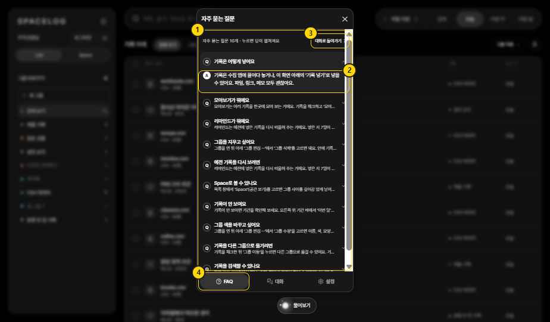

**자주 묻는 질문**

1. 질문 목록(안에서 스크롤)
2. 펼친 답
3. 대화로 돌아가기
4. FAQ 탭

- **흐름:** ④ FAQ 탭 또는 새 대화의 ‘자주 묻는 질문 →’(F-19 B③) → 창이 넓어지며 ① 목록. 질문을 누르면 ② 답이 토글로 펼쳐집니다. ③ 대화로 돌아가기.
- **규칙·제한:** 처음에는 모두 닫혀 있습니다. 창은 하단 버튼과 겹치지 않고, 내용만큼만 커집니다.
- **문구:** 질문 목록은 화면 기준(‘이어보기’ → ‘모아보기’, ‘재발견 혜성’ → ‘리마인드’로 통일). 시안 v3 목록: `기록은 어떻게 넣어요` · `이번 주 기록 알려주세요` · `AI 분석이 뭐예요` · `그룹을 지우고 싶어요` · `Space로 볼 수 있나요` · `기록이 안 보여요` · `그룹 색을 바꾸고 싶어요` · `기록을 다른 그룹으로 옮기려면` · `기록을 검색할 수 있나요`, 맨 아래 어두운 회색 `모아보기가 뭐예요 (준비중)` · `예전 기록을 다시 보려면 (준비중)`. `리마인드가 뭐예요`는 뺐습니다. `분류 안 된 기록 정리해줘`는 시안에 없지만 2026-11-28 결정대로 둡니다.
- **미정:** —

### F-23 챗봇 설정

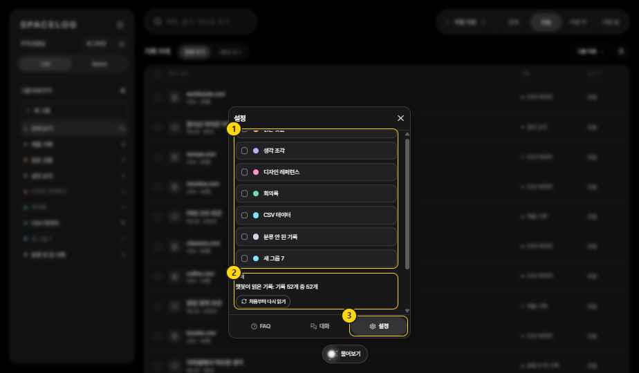

**챗봇 설정**

1. 챗봇이 읽지 않을 그룹(체크 목록)
2. ‘챗봇이 읽은 기록: 기록 n개 중 n개’ (시안 v3에서 삭제. 캡처의 ‘처음부터 다시 읽기’ 버튼도 삭제됨)
3. 설정 탭

- **흐름:** ③ 설정 탭 맨 위 ① 챗봇이 읽지 않을 그룹 → 그룹 체크 목록.
- **규칙·제한:** 체크한 그룹은 AI 활용 꺼짐이 됩니다. 그 기록은 답과 출처에 쓰지 않고, AI 분석(F-14)과 기록 상세 AI 추천(F-13)도 막습니다. 자동 가공(글자 추출·검색 색인)은 그대로입니다 (2026-11-28 결정). 챗봇 켜기/끄기는 없습니다(항상 켜짐).
- **문구:** `챗봇이 읽지 않을 그룹`

### F-24 설정 · 계정

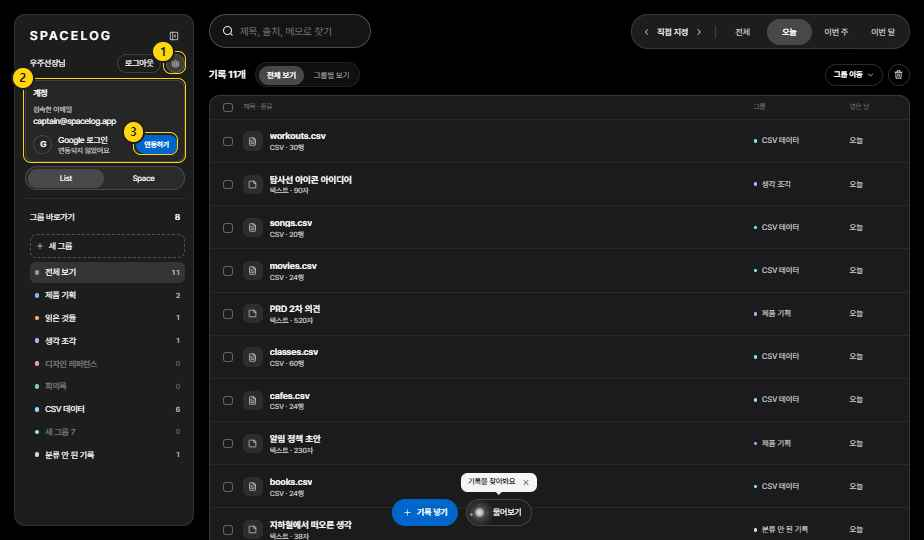

**계정 영역**

1. 설정 버튼
2. 계정 영역(목록 창 안에 펼쳐짐)
3. 연동하기

- **흐름:** 목록 창 ① 설정 버튼 → 목록 창 안에 ② 계정 영역이 펼쳐집니다(별도 창 아님): 맨 위 닉네임(연필 아이콘으로 수정) · 이메일(캡션), 구분선 아래 Google 줄과 ③ `연동하기` 또는 `연동 해제`.
- **규칙·제한:** 미연동 → `연동하기`, 연동 후 → `연동 해제` 하나만(연동 상태 글자 없음). Google 줄은 이메일 계정으로 로그인했을 때만 보입니다 (2026-11-28 결정. 시안 v3는 Google 로그인 계정에도 보여 줘 결정과 다름). 닉네임은 2~12자, ✓ 저장 · ✕ 취소. 이메일이 길면 `…`로 자르고, 잘렸을 때만 `⌄`로 펼칩니다.
- **예외:** 로그인 전 → `먼저 로그인해 주세요`
- **오류·권한 (미정):** 연동 실패 → `Google 연동에 실패했어요`(미정), 상태는 미연동 유지.
- **문구:** `Google 계정을 연동했어요`, `Google 연동을 해제했어요`, `닉네임 수정`, `마이페이지는 준비 중이에요`
- **미정 · 프로토타입 한정:** 이메일은 임시값(`captain@spacelog.app`). 연동은 표시만 바뀝니다.

### F-25 모바일 형식

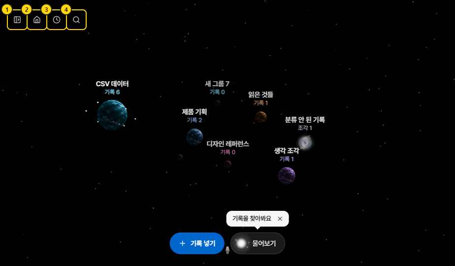

**[A] 상단 한 줄**

1. 목록 열기
2. 홈
3. 시계(기간)
4. 검색

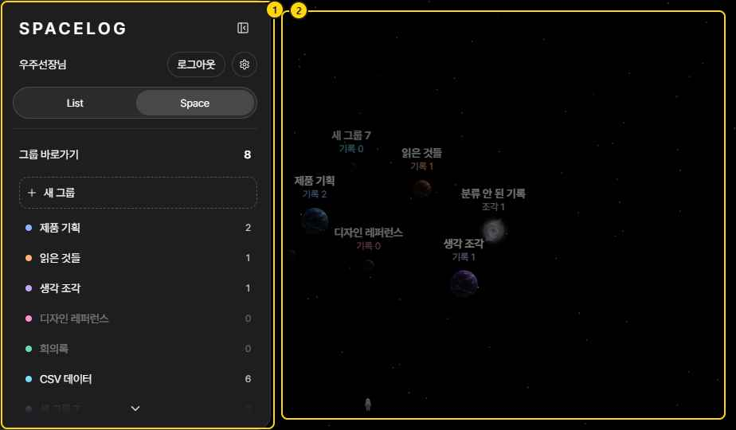

**[B] 사이드바**

1. 사이드바(목록 창)
2. 어두운 덮개. 누르면 닫힘

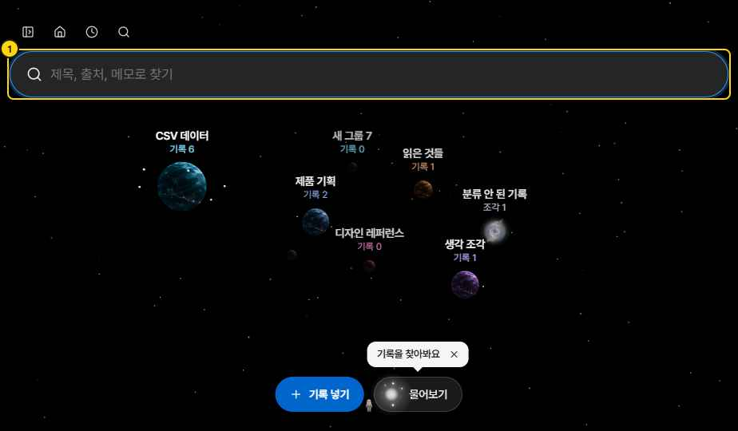

**[C] 검색**

1. 검색창(전체 폭)

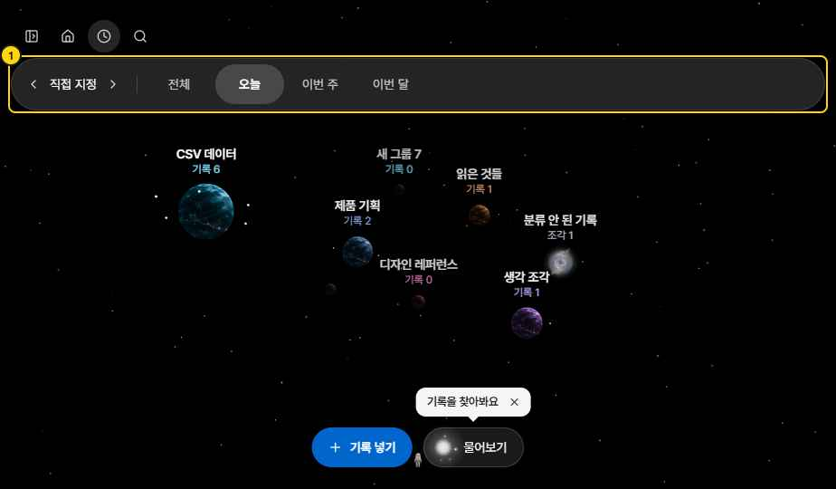

**[D] 기간**

1. 기간 바(전체 폭)

- **흐름:** 상단 한 줄: 왼쪽 A① 목록 열기 · A② 홈 · A③ 시계(기간) · A④ 검색. 시계를 누르면 D① 기간 바, 검색을 누르면 C① 검색창이 상단바 아래에 나옵니다.
- **규칙·제한:**
  - 목록 창 = 왼쪽 사이드바(폭 86%, 최대 340px). 바깥 어두운 덮개를 누르면 닫힘. 열린 동안 ‘기록 넣기’·‘물어보기’ 숨김.
  - 그룹을 고르거나 List/Space를 바꾸면 사이드바가 닫힙니다.
  - 기간 바·검색바: 높이 58px, 위 64px, 좌우 12px.
  - 상단바 아래로 지나가는 내용과 헷갈리지 않게 위쪽에 바탕색 그라데이션.
  - 창(그룹 창, 상세)은 상단바 아래 72px부터 엽니다.
- **미정:** 실제 기기 확인 필요(꾹 누르기, 호버 제거).

### F-26 로그인 · 로그아웃

- **흐름:** 목록 창 사용자 이름 옆 로그아웃(F-01 A②). 로그인 전에는 같은 자리에 로그인.
- **상태:** 로그인 전 / 로그인됨.
- **규칙·제한:** 로그아웃해도 기기에 남긴 보기 방식은 유지합니다. 기록과 챗봇 대화 목록은 계정 데이터라 보이지 않게 합니다. 로그아웃하면 로그인 페이지로 가고 `로그아웃했어요. 다시 로그인하면 기록을 볼 수 있어요.`를 보여 줍니다. 로그아웃 상태로 홈에 들어오면 로그인 페이지로 보냅니다.
- **로그인 페이지 (S-00):** 첫 화면 · 이메일 로그인 · 비밀번호 재설정 · 회원가입. 문구와 오류는 `docs/spec/screens/02-login.md` (시안 `docs/design/spacelog-login-v3.html`). 이메일 가입은 인증 메일 없이 바로 로그인됩니다 (2026-11-28 결정).
- **예외 (미정):** 로그아웃 확인은 묻지 않습니다(제안).
- **오류·권한:** 0-7 로그인 만료 참고.
- **반응형:** 모바일은 사이드바 안 같은 자리.
- **문구:** `로그인`, `로그아웃`, 사용자 이름(프로토타입 `우주선장`)
- **미정 · 프로토타입 한정:** v2 프로토타입은 로그인 상태 고정이고, 로그인 화면은 시안 v3에 있습니다. 로그인 방법은 이메일 자체 로그인과 Google 로그인 둘 다입니다(2026-11-28 결정). 계정 영역의 Google 연동은 이메일 계정에 Google 계정을 연결하는 것이고, Google로 로그인한 계정에는 보이지 않습니다.

---

## 3. 데이터 정의

### 기록 (star)

| 항목 | 내용 | 비고 |
| --- | --- | --- |
| `id` | 고유값 |  |
| `planet` | 그룹 id | 분류 안 된 기록은 `p0` |
| `kind` | `file` / `image` / `link` / `text` | 미리보기 규칙이 달라짐 |
| `title` | 제목 | 비우면 파일 이름 |
| `meta` | 종류·크기 요약. 예) `PDF · 640KB`, `CSV · 20행` |  |
| `memo` | 메모 | 자동 저장 |
| `url` | 링크 | 없으면 ‘링크 추가하기’ |
| `thumb` | 썸네일 이미지 | 텍스트 기록은 쓰지 않음 |
| `addedAt` | 넣은 시각 | 기간·N일 전 계산 기준 |

### 그룹 (planet)

| 항목 | 내용 |
| --- | --- |
| `id`, `name` | 고유값, 이름(중복 불가) |
| `accent` | 그룹 색 |
| `shape` | 기본 / ring(고리) / nebula(성운) / earth(지구) / probe(탐사선) |
| `unsorted` | 분류 안 된 기록 그룹 여부 |

### AI 분석 (기록별)

| 항목 | 내용 |
| --- | --- |
| `sum` | 핵심 1줄 |
| `pts` | 요약 3개 |
| `rel` | 함께 볼 만한 기록 id (최대 3개) |
| `at` | 분석 시각 |

---

## 4. 보류 · 숨김 기능

코드에는 남아 있지만 v2 화면에서는 보이지 않습니다. 구현 범위에서 빼 주세요.

| 기능 | 상태 |
| --- | --- |
| 모아보기(이어보기) 만들기·보기 | 보류. 나중에 다시 넣을 예정 |
| 리마인드 카드(‘N일 전 오늘의 기록’) | 목록 창에서 숨김 |
| 위치 편집 · 블랙홀(그룹 보관) | Space에서 숨김 |
| 관측소 · 탐사선 · 체험 가이드 | 삭제 |
| 2D 보기 | 삭제 (2.5D를 Space로 이름 변경) |
| 배경 음악 · 효과음 | 삭제 |
| 브라이트(라이트) 모드 | 삭제. 다크 모드만 씁니다 |

---

## 5. 정해야 할 것 (모아 보기)

1. AI 연결: 챗봇 답, AI 분석, 기록 상세의 그룹 추천. 대상 범위, 횟수·비용, 실패 문구.
2. 파일: 최대 크기, 지원 형식, 한 번에 넣는 개수.
3. 메모 최대 길이, 저장 실패 안내.
4. 그룹 최대 개수.
5. 지운 기록·그룹 되살리기 여부와 기간.
6. 검색 결과 0개일 때 기간 넓히기 안내.
7. 상세 머리줄 `←` 를 직전 기록으로 돌아가게 할지 (F-15).
8. 달력 ‘적용’ 버튼 (F-03).
9. 공통 오류 문구 중 (미정)으로 남은 것 (0-7).
10. AI 분석 결과에 ‘함께 볼 만한 기록’을 남길지 (F-14).
11. 긴 답 기준과 요약 창 내용을 만드는 방식 (F-21).

---

## 6. 검토 결과

프로토타입 v2 코드와 이 문서를 기능별로 대조하고, 화면을 캡처한 결과입니다.

| 기능 | 캡처 | 프로토타입 동작 | 구현 때 정할 것 |
| --- | --- | --- | --- |
| F-01 목록 창 | 있음 | 동작 | 로그아웃·마이페이지 |
| F-02 보기 전환 | — | 동작 | — |
| F-03 기간 바 | 있음 | 동작 | 달력 ‘적용’ 버튼 |
| F-04 검색 | 있음 | 동작 | 파일 본문 검색, 0개일 때 안내 |
| F-05 그룹 관리 | 있음 | 동작 | 최대 개수 |
| F-06 List 목록 | 있음 | 동작 | 더 불러오기 |
| F-07 체크와 일괄 동작 | 있음 | 동작 | 되살리기 |
| F-08 분류 안 된 기록 | 있음 | 동작 | — |
| F-09 Space 보기 | 있음 | 동작 | — |
| F-10 그룹 창 | 있음 | 동작 | — |
| F-11 기록 상세 | 있음 | 동작 | 링크 형식 검사 |
| F-12 메모 | — | 동작(실패 없음) | 최대 길이, 실패 문구 |
| F-13 그룹 바꾸기 | 있음 | 동작 | — |
| F-14 AI 분석 | 있음 | 예시 문장 | 실제 AI 연결 |
| F-15 돌아가기 띠 | 있음 | 동작 | 머리줄 ← 동작 |
| F-16 기록 삭제 | — | 동작 | 되살리기 |
| F-17 기록 넣기 | 있음 | 동작(AI 추천은 규칙) | 파일 크기·형식 |
| F-18 물어보기 버튼 | — | 동작 | — |
| F-19 챗봇 창 | 있음 | 정해진 답 | 실제 AI 연결 |
| F-20 챗봇 답 | — | 동작 | — |
| F-21 긴 답 새 창으로 보기 | 있음 | 예시 답 | 긴 답 기준 |
| F-22 자주 묻는 질문 | 있음 | 동작 | 숨긴 기능 질문 정리 |
| F-23 챗봇 설정 | 있음 | 동작 | — |
| F-24 설정 · 계정 | 있음 | 표시만 바뀜 | 실제 연동 |
| F-25 모바일 형식 | — | 동작 | 실제 기기 확인 |
| F-26 로그인 · 로그아웃 | — | 고정 | 로그인 방법 |

## 7. 변경 이력

| 날짜 | 내용 |
| --- | --- |
| 2026-11-27 | v2 변경 기록(`handoff.md`): List 기간 순서, 체크·일괄 동작, 모바일 형식 1100px, 메모 자동 저장, 그룹 지우기 확인 |
| 2026-11-28 | 공통 오류·권한(0-7), 기준값(0-8), 로그인·로그아웃(F-26), 기능별 캡처, 검토 결과 추가 |
| 2026-11-28 | 챗봇 입력창 4줄, 보내기 버튼·탭 강조 낮춤, 긴 답 크게 보기, AI 분석, 돌아가기 띠, 텍스트 기록 미리보기 숨김, 챗봇 설정 정리 |
| 2026-11-28 | AI 분석·챗봇 답 형식을 한 줄 요약 · 핵심 내용 3개로 통일(파일 내용 + 메모 기준, 보고서 형식 미사용), 다시 분석 활성 조건 추가 |
| 2026-11-28 | 브라이트 모드 삭제(다크 모드만 사용): F-25 밝기 모드 삭제, 기능별 ‘브라이트 모드’ 칸 삭제, F-26 → F-25 · F-27 → F-26으로 번호 변경 |
| 2026-11-28 | 챗봇 설정(F-23)에서 ‘처음부터 다시 읽기’ 버튼 삭제 |
| 2026-11-28 | 시안 버전을 저장소 기준(v2)으로 고침: 문서 제목에서 v3 삭제, 기준 파일 `docs/design/spacelog-prototype-v2.html`, 본문의 v3 프로토타입·화면 → v2 |
| 2026-11-28 | v3 반영(`spacelog-prototype-v3.html`, `spacelog-login-v3.html`)과 팀 결정: 공통 상태(0-7), 로그인 화면(S-00, F-26), 계정 닉네임·Google 줄(F-24), AI 추천을 기록 상세로 옮김(F-13, F-17), AI 분석 표기를 ‘핵심 1줄 + 요약 3개’로 되돌림·다시 분석 10자 규칙·실패 문구·AI 활용 꺼짐(F-14), 긴 답 새 창·묶음 분석 보고서·바로가기·못 찾음 안내(F-20, F-21), FAQ 목록(F-22), 챗봇 설정 ‘읽은 기록’ 삭제(F-23) |

